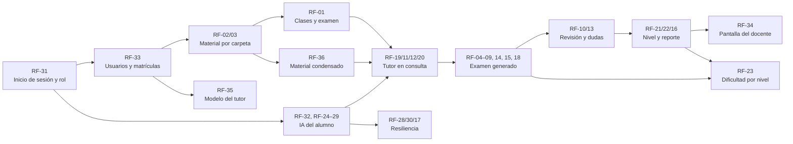

# 2. Requisitos

[← 1. Introducción](01-introduccion.md) · [Índice del SDD](SDD-Plataforma-Evaluacion-PreClase.md) · [3. Arquitectura del sistema →](03-arquitectura.md)

## 2.1 Funcionales

| ID | Requisito | Prioridad |
| --- | --- | --- |
| RF-01 | El docente crea una clase con fecha/hora de inicio. **La clase se habilita para el alumno al llegar esa fecha**: antes la ve en su lista, bloqueada, y no puede abrir el chat, leer el material ni rendir el examen. El examen no tiene fechas propias (ni apertura ni límite) | Alta |
| RF-02 | El docente sube el contenido copiándolo a la carpeta de contenido, una subcarpeta por clase (PDF, PPTX, DOCX, XLSX, MD, TXT); lo que quita de la carpeta se retira de la clase | Alta |
| RF-03 | El sistema extrae el texto del contenido automáticamente al subirlo, conservando archivo y página | Alta |
| RF-04 | La IA genera un examen propio para cada alumno en cada intento, a partir del material de la clase y con su propio criterio, **pregunta a pregunta**: al empezar solo la primera, y cada siguiente mientras el alumno responde la anterior, sin repetir lo ya preguntado. El docente no escribe ni aprueba preguntas | Alta |
| RF-05 | Cada pregunta generada tiene 4 alternativas con una sola correcta, un tema y una justificación que cita el material; el servidor descarta las que no cumplen | Alta |
| RF-06 | El tutor usa el modelo que habilita el administrador; al iniciar el examen el modelo queda fijado en el intento | Alta |
| RF-07 | El agente conduce el examen por chat: presenta cada pregunta, interpreta la respuesta en lenguaje natural y la registra mediante una herramienta del servidor | Alta |
| RF-08 | El examen se rinde desde que la clase se habilita (RF-01), sin fecha límite, con un número configurable de intentos por el docente (por defecto 3) | Alta |
| RF-09 | El servidor calcula el puntaje (0–20, escala peruana) y el porcentaje; el agente solo lo comunica | Alta |
| RF-10 | El agente explica cada pregunta fallada como tutor: por qué falló, el concepto correcto y una pregunta de comprobación | Alta |
| RF-11 | El alumno puede repreguntar al agente sobre cualquier fallo o tema de la clase; el tutor responde primero con el contenido del docente y cita archivo y página. **Cada referencia permite descargar el archivo citado** | Alta |
| RF-12 | Si el contenido no cubre la duda, el tutor lo dice explícitamente y puede ampliar con su propio conocimiento, marcando esa parte como *ampliación fuera del material*; nunca la presenta como contenido del docente | Alta |
| RF-13 | El docente ve qué dudas pidieron los alumnos, cuáles no cubría su material y qué ampliaciones dio el tutor | Media |
| RF-14 | El docente elige por examen el modo de feedback: Inmediato o Al final (por defecto) | Media |
| RF-15 | El agente no revela respuestas ni da pistas mientras el examen está en curso | Alta |
| RF-16 | El docente ve un reporte por clase: promedio, distribución de notas, temas más fallados y modelo usado | Media |
| RF-17 | Si el proveedor falla, el alumno reintenta sin perder el avance; el administrador puede cambiar de modelo sin desplegar | Media |
| RF-18 | Temporizador opcional por examen | Baja |
| RF-19 | Fuera del examen, el alumno puede conversar con el tutor sobre el tema de la clase (modo Consulta); el tutor declina cortésmente lo ajeno al curso | Alta |
| RF-20 | La ampliación viene desactivada: el tutor se limita al material de la clase. El docente puede activarla por clase | Media |
| RF-21 | El sistema clasifica el nivel del alumno por clase (Inicial, Básico, Intermedio, Avanzado) combinando sus notas con el diagnóstico de temas débiles del tutor | Alta |
| RF-22 | El reporte del docente incluye nivel por alumno, distribución de niveles y temas débiles del grupo | Alta |
| RF-23 | La IA ajusta la dificultad del examen al nivel vigente del alumno | Baja |
| RF-24 | El alumno conecta, reconecta o desconecta su cuenta de IA desde el chat, sin pasar por el docente: con un clic si es por OAuth (Gemini con Google) o pegando su clave (RF-38). *OpenRouter, la primera cuenta por OAuth, está retirado* | Alta |
| RF-25 | La credencial obtenida al conectar se valida contra el proveedor antes de guardarla; si no sirve, se avisa y no se guarda | Alta |
| RF-26 | La credencial se guarda cifrada y nunca se devuelve: la web solo ve el proveedor, los últimos 4 caracteres y la fecha de conexión | Alta |
| RF-27 | Sin cuenta conectada, el chat muestra un único botón para conectarla y no deja escribir | Alta |
| RF-28 | Si el proveedor rechaza la credencial durante una conversación, se marca como inválida y se pide reconectarla | Media |
| RF-29 | Los agentes de inicio de sesión (hoy, Gemini con Google) se conectan solo por OAuth con PKCE y no aceptan claves pegadas. Los agentes de tipo *Clave* (RF-38) sí aceptan la clave de API del alumno: se comprueba su forma y con el proveedor antes de guardarla, se cifra, nunca se devuelve ni se registra, y la web solo muestra sus últimos 4 caracteres | Alta |
| RF-30 | Si el proveedor corta por límite de uso (HTTP 429), el chat dice cuándo puede volver, sin marcar la credencial como inválida ni perder el avance | Media |
| RF-31 | Todos los usuarios entran por una única página de inicio de sesión con la cuenta de la universidad (OAuth / OpenID Connect); el sistema reconoce su rol (Alumno, Docente, Administrador) y lo lleva a su pantalla | Alta |
| RF-32 | Al entrar, al alumno que no tiene ninguna IA conectada se le abre *Mi tutor* para conectarla; si solo hay una opción por cuenta (hoy, Gemini), va directo a autorizarla una vez por sesión y vuelve al chat listo | Alta |
| RF-33 | Autorregistro: en la página de entrada la persona elige primero su perfil, **alumno** o **profesor**, y luego entra con Google, sin aprobación de nadie. Un profesor puede entrar también como alumno. El alumno elige además a su profesor y solo ve los cursos de ese profesor; puede cambiarlo después. El administrador puede corregir roles y matrículas. Con el registro cerrado, solo entran los registrados | Alta |
| RF-34 | El profesor administra el contenido de **sus** cursos (su carpeta `course-content/<su correo>/`) y tiene su pantalla: estado del material, ajustes del examen y de la ampliación de cada clase y el reporte (RF-13, RF-16, RF-22). No ve ni toca los cursos de otro profesor | Alta |
| RF-35 | El administrador elige el modelo de IA que usa el tutor y puede cambiarlo sin desplegar (RF-06, RF-17) | Media |
| RF-37 | Cada usuario conecta **sus propias cuentas de IA** y elige con cuál conversar. Por cuenta, hoy: **Gemini con su cuenta de Google** (OAuth, sin claves). ChatGPT y Claude no ofrecen OAuth para usar la suscripción del usuario desde otra app: su vía es la clave de API propia (RF-38). OpenRouter está retirado: un agente con `Habilitado: false` en la configuración no se lista, no se puede conectar ni se usa como respaldo, aunque queden cuentas conectadas de antes | Alta |
| RF-38 | El alumno puede usar el modelo de **su propia cuenta de desarrollador** pegando su clave de API de **OpenAI** (ChatGPT), **Anthropic** (Claude) o **Google AI Studio** (Gemini). Cada uno es un agente de tipo *Clave* con su modelo, que fija el administrador (RF-35). Las suscripciones ChatGPT Plus o Claude Pro no incluyen claves de API | Alta |
| RF-39 | **El Tutor como servidor MCP**: el alumno genera en la web un token personal y conecta su propio asistente (Claude Code, Claude Desktop u otro cliente MCP) a `/mcp`. Su asistente lista sus clases, lee y busca en el material con citas, y le toma el examen pregunta a pregunta con las mismas reglas del servidor: ventana, intentos, nota calculada por el servidor y la respuesta correcta oculta hasta finalizar. El token se muestra una sola vez, se guarda hasheado, solo vale en `/mcp` y se puede revocar | Media |
| RF-36 | Al subir el material, la IA lo **condensa una sola vez**: reescribe cada página como apuntes compactos (definiciones, cifras, fórmulas y pasos, sin relleno), conservando su cita `[archivo, p. N]`, para que el tutor lea menos y responda más rápido. Se hace con la cuenta de IA del profesor (Gemini); el profesor ve el original y los apuntes lado a lado y puede elegir el original por archivo. El examen se sigue generando con el original | Media |

## 2.2 Requisitos por rol, dependencias y orden de implementación

**Por rol.** Cada requisito tiene un rol que lo ejerce; los del *Sistema* no los dispara nadie, pero sostienen a los demás.

| Rol | Requisitos |
| --- | --- |
| Todos | RF-31 inicio de sesión y rol |
| Administrador | RF-33 corregir roles y matrículas · RF-35 modelo del tutor |
| Docente (profesor) | RF-33 registrarse como profesor · RF-02 subir material a su carpeta · RF-36 conectar su cuenta de IA y revisar los apuntes · RF-01 clases y su fecha · RF-14 modo de feedback · RF-18 temporizador · RF-20 ampliación · RF-34 su pantalla · RF-13, RF-16, RF-22 reporte |
| Alumno | RF-33 registrarse y elegir profesor · RF-32, RF-37, RF-38 y RF-24–RF-27, RF-29 conectar Gemini o su clave de API · RF-39 estudiar desde su asistente (MCP) · RF-19 consulta · RF-11 repreguntar · RF-06, RF-07 rendir el examen · RF-10 revisar errores |
| Sistema | RF-03 extraer texto · RF-04, RF-05 generar el examen · RF-08, RF-09 intentos y nota · RF-12, RF-15 límites del tutor · RF-21 nivel · RF-23 dificultad adaptativa · RF-17, RF-28, RF-30 resiliencia |

**Dependencias.** Una flecha `A --> B` significa "B no funciona sin A":

Lo que casi todo necesita es saber **quién es el usuario y qué rol tiene** (RF-31) y **qué cursos le tocan** (RF-33): sin eso no hay a quién mostrar clases, a quién cobrarle la IA ni quién ve el reporte. Por eso el acceso va primero. En desarrollo existe además una entrada "como usuario de prueba" que emite la misma sesión sin pasar por Microsoft ni Google; en producción no está.

**Orden de implementación** (por dependencia y, a igual dependencia, por prioridad). El estado es el del código a la fecha de este documento:

| Orden | Bloque | Requisitos | Estado |
| --- | --- | --- | --- |
| 1 | Acceso e identidad | RF-31, RF-33 | Hecho y probado con Google (proyecto `tutor-pre-clase`). La entrada con Microsoft se retiró: la cuenta UPC de alumno no puede registrar apps en Entra (403) |
| 2 | Material del docente | RF-02, RF-03, RF-01 | Hecho (carpeta sincronizada; reprogramar la fecha de una clase aún no tiene endpoint) |
| 3 | Conexión del alumno | RF-32, RF-24–RF-27, RF-29 | Hecho |
| 4 | Tutor en consulta | RF-19, RF-11, RF-12, RF-20 | Hecho |
| 5 | Examen generado por IA | RF-04, RF-05, RF-06, RF-07, RF-08, RF-09, RF-14, RF-15, RF-18 | Hecho; RF-05 sin guardar referencias en `pregunta_referencia`; falta validar la calidad con el modelo real |
| 6 | Revisión | RF-10, RF-13 | Hecho |
| 7 | Seguimiento del docente | RF-21, RF-22, RF-16, RF-34 | Hecho: el panel muestra los resultados por alumno y permite ajustar el examen de cada clase |
| 8 | Resiliencia y administración | RF-28, RF-30, RF-17, RF-35 | RF-28, RF-30 y RF-17 hechos (botón *Reintentar* en el chat); RF-35 solo por API |
| 9 | Mejora | RF-23 | Pendiente |
| 11 | Cuentas de IA propias | RF-37, RF-38, RF-39 | Hecho: Gemini con OAuth de Google; claves propias de OpenAI, Anthropic y Google AI Studio; el Tutor como servidor MCP con token personal; *Mi tutor* con pestañas. Falta OAuth para los conectores web de Claude.ai y ChatGPT, y proyecto de Google propio |
| 10 | Material condensado | RF-36 | Hecho: condensación por página con la cuenta del profesor, reintento automático si el modelo gratuito está saturado, comparación y elección del original en el panel. Falta medir la reducción real con el modelo (el 2026-09-30 el pool gratuito estaba saturado) |

## 2.3 No funcionales

| ID | Requisito |
| --- | --- |
| RNF-01 | Registro y calificación de respuestas en menos de 1 s, sin depender del LLM |
| RNF-02 | Primer token del agente en menos de 3 s (streaming SSE) |
| RNF-03 | Soporte para 30 alumnos concurrentes rindiendo examen |
| RNF-04 | Extracción de texto de una carpeta de 50 MB en menos de 5 min (asíncrona) |
| RNF-05 | Disponibilidad 99,5 % en horario académico |
| RNF-06 | Datos personales tratados según la Ley N.° 29733 de Protección de Datos Personales (Perú); a los proveedores de IA no se envían nombre ni correo del alumno |
| RNF-07 | Interfaz en español, responsive (móvil y escritorio); para el alumno, una sola pantalla de chat |
| RNF-08 | Límite de consumo IA por alumno por clase (p. ej. 60 mensajes, incluido el examen); con el modelo gratuito el tope protege el cupo diario del alumno |
| RNF-10 | Las credenciales de los alumnos se cifran en reposo, no se escriben en logs y no salen nunca de la API; la obtenida por OAuth tampoco pasa por el navegador |
| RNF-11 | *(Solo aplica a la pasarela de OpenRouter, hoy retirada.)* Cada llamada pide a OpenRouter solo proveedores que no guardan ni entrenan con los datos (`provider.data_collection = deny`), sin que el alumno toque su configuración de privacidad; un modelo gratuito solo se habilita si tiene alguno así, y si con el límite diario de OpenRouter sin créditos (50 llamadas) alcanza para generar un examen (una llamada), rendir sus 6 preguntas y revisarlo. El límite cuenta **llamadas al proveedor**, no mensajes del alumno: cada vuelta de herramientas es una llamada, así que se mide con la suite de paridad antes de habilitarlo |

---

[← 1. Introducción](01-introduccion.md) · [Índice del SDD](SDD-Plataforma-Evaluacion-PreClase.md) · [3. Arquitectura del sistema →](03-arquitectura.md)
