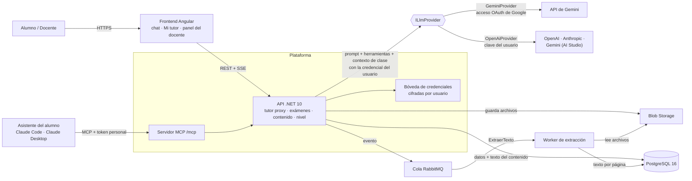

# 3. Arquitectura del sistema

[← 2. Requisitos](02-requisitos.md) · [Índice del SDD](SDD-Plataforma-Evaluacion-PreClase.md) · [4. Modelo de datos →](04-modelo-de-datos.md)

Para la v1 se propone un monolito modular en .NET con un worker separado para la extracción de texto, porque el volumen (decenas de alumnos por clase) no justifica microservicios y simplifica el despliegue. El frontend es deliberadamente delgado: dibuja el chat y no toma ninguna decisión del examen.

La API nunca espera a la extracción: al subir un archivo publica un evento y el worker extrae el texto página por página y lo guarda en PostgreSQL.

En la v1 desplegada, la cola y el worker corren dentro del mismo proceso de la API (una cola en memoria y un servicio en segundo plano, con el mismo contrato), y los archivos van a un volumen de Railway. RabbitMQ y Blob Storage llegan cuando la carga lo pida. La §5.9 dibuja la arquitectura desplegada, con cada forma de llegar al modelo de IA y sus flujos.

## 3.1 Módulos del backend

- **Clases y contenido**: CRUD de cursos/clases, subida de archivos, estado de extracción y armado del contexto de clase.
- **Generador de examen**: `GeneradorExamen` pide a la IA, en una llamada aparte del chat, las preguntas de cada intento a partir del contexto de clase; valida su forma y baraja las alternativas en el servidor.
- **Evaluación**: intentos, registro de respuestas, calificación determinista (sin IA) y reglas de intentos y tiempo.
- **Agente tutor (proxy)**: `AgenteTutorService` orquesta la única conversación del alumno en sus tres modos (Evaluación, Revisión, Consulta), expone las herramientas del servidor y decide qué puede ver y decir el agente en cada modo.
- **Capa de proveedores de IA**: `ILlmProvider` con dos adaptadores. `GeminiProvider` habla la API propia de Gemini con el acceso OAuth de la cuenta de Google del usuario; `OpenAiProvider` habla el formato de chat de OpenAI y sirve a los tres agentes de clave propia (OpenAI, Anthropic y Gemini de AI Studio), cada uno con su ruta. `ProveedorLlmFactory` elige el adaptador según el agente. La credencial se inyecta por llamada: el adaptador no guarda ninguna. Otro proveedor es una implementación más y una entrada de configuración (RNF-09).
- **Credenciales**: `BovedaCredenciales` cifra, valida (`ValidadorCredencial`) y entrega la credencial del usuario dueño de la conversación, y solo a él. `ConexionGoogleGemini` conduce el OAuth con PKCE de Google y deja el refresh token en la misma bóveda; `TokensGoogle` lo cambia por accesos de una hora.
- **Servidor MCP**: `HerramientasMcp` expone en `/mcp` las clases, el material y el examen del alumno a su propio asistente, autenticado con un token personal (`ServicioTokenMcp`). Usa los mismos servicios y las mismas reglas que el chat (RF-39).
- **Material condensado**: `CondensadorMaterial` reescribe cada página como apuntes con la IA que el profesor tenga conectada (RF-36).
- **Nivel del alumno**: `NivelService` combina las notas de los intentos con el diagnóstico del tutor y mantiene el nivel vigente por clase.
- **Reportes**: agregados por clase, pregunta, nivel y agente para el docente.
- **Identidad**: autenticación OIDC y roles (Alumno, Docente, Admin).

## 3.2 Stack tecnológico

| Capa | Tecnología | Motivo |
| --- | --- | --- |
| Frontend | Angular + Nx, Angular Material | SPA responsive; monorepo para librerías compartidas |
| Backend | ASP.NET Core (.NET 10), EF Core | LTS, tipado fuerte, streaming SSE nativo |
| Worker | .NET Worker Service + MassTransit | Procesa la cola de extracción de texto con reintentos |
| Extracción de texto | PdfPig (PDF), Open XML SDK (DOCX/PPTX/XLSX) | Librerías .NET sin dependencias externas |
| Base de datos | PostgreSQL 16 | Datos relacionales y texto del contenido en una sola base |
| Archivos | Volumen de Railway en la v1; Azure Blob Storage o Amazon S3 más adelante | Almacenamiento barato del contenido original |
| Cola | RabbitMQ | Desacopla subida y extracción de texto |
| LLM | Gemini con la cuenta de Google del usuario (`GeminiProvider`), y OpenAI, Anthropic y Gemini de AI Studio con la clave de API del usuario (`OpenAiProvider`), todos vía `ILlmProvider` | Cada usuario conecta sus propias cuentas y elige con cuál conversar (RF-37, RF-38); el modelo de cada agente se cambia por configuración |
| MCP | SDK oficial de MCP para .NET, transporte HTTP sin estado | El asistente del alumno usa el Tutor como herramienta (RF-39) |
| Autenticación | OpenID Connect con Google; sesión propia firmada por la API | Sin contraseñas propias; el rol lo decide la plataforma |
| Cifrado de credenciales | ASP.NET Data Protection, con clave por usuario | Cifrado en reposo sin montar un KMS para la v1 |
| Despliegue | API en Docker sobre Railway (con PostgreSQL) y web estática en Vercel, desplegadas por GitHub Actions solo con el CI en verde (`docs/DESPLIEGUE.md`); Azure Container Apps o AWS ECS si la universidad lo exige | Barato para la v1, un despliegue por push a `main` y escalado horizontal más adelante |

---

[← 2. Requisitos](02-requisitos.md) · [Índice del SDD](SDD-Plataforma-Evaluacion-PreClase.md) · [4. Modelo de datos →](04-modelo-de-datos.md)
