# 5. Flujos principales con el agente tutor

[← 4. Modelo de datos](04-modelo-de-datos.md) · [Índice del SDD](SDD-Plataforma-Evaluacion-PreClase.md) · [6. Módulo de contenido de clase →](06-contenido-de-clase.md)

Todo ocurre en un solo chat por clase. El `AgenteTutorService` es el intermediario: recibe el mensaje del alumno, decide en qué **modo** está la conversación y arma la llamada al proveedor con el contenido del docente, las herramientas permitidas y las reglas de ese modo.

| Modo | Cuándo | Qué puede hacer el tutor |
| --- | --- | --- |
| Consulta | Antes del examen, o después de cerrada la revisión | Responder dudas del tema con el material; ampliar marcando la ampliación |
| Evaluación | Examen en curso | Solo presentar preguntas y registrar respuestas; sin pistas, sin explicaciones, sin ampliación |
| Revisión | Tras finalizar el examen | Comunicar la nota, explicar cada fallo, responder repreguntas y ampliar marcando |

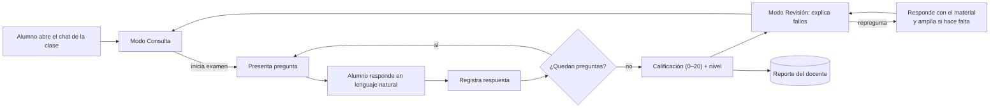

*Flujo en modo Al final.* En modo *Inmediato* el tutor explica cada error apenas se registra la respuesta; en modo *Al final* (por defecto) espera al cierre del examen para no influir en las respuestas siguientes. El docente elige el modo por examen.

## 5.0 Inicio de sesión y rol

Todos entran por la misma página (RF-31). **Primero eligen el perfil** (*Soy alumno* / *Soy profesor*) y después entran con *Continuar con Google*:

1. La web pide a la API la URL del proveedor con el perfil elegido (`POST /acceso/{proveedor}/inicio { perfil }`); la API genera `state`, `nonce` y el verificador PKCE y los guarda 10 minutos **junto con el perfil**, que así no viaja por la URL ni se puede alterar al volver.
2. La persona inicia sesión en Google y vuelve a `/entrar/{proveedor}?code=…&state=…`.
3. La API canjea el código directamente con el proveedor (por TLS, con su secreto de cliente) y valida el `id_token`: emisor, audiencia, vigencia, `nonce` y correo verificado.
4. Busca al usuario por ese correo (RF-33):
   - Ya registrado: entra con el perfil elegido. Un **profesor puede entrar como alumno** (la sesión lleva rol Alumno y `vistas: [Docente, Alumno]`): ve el chat, elige profesor —incluido él mismo— y conserva sus propios cursos. Un **alumno que entra como profesor pasa a ser profesor** (y puede seguir entrando como alumno). Un profesor cuya carpeta ya existía quedó registrado por el sincronizador con su correo; al entrar se toma su nombre.
   - Correos de `Acceso:Administradores`: entran como administrador.
   - Primera vez, con `Acceso:RegistroAbierto = true` (por defecto): como **profesor**, se crea y entra directo; como **alumno**, el canje no crea a nadie y devuelve un **registro pendiente** (token de un solo uso, 10 min) para que elija a su profesor de la lista (`GET /acceso/profesores`, con los cursos de cada uno); `POST /acceso/registro` crea al usuario y emite la sesión. Nadie puede elegirse administrador.
   - Con el registro cerrado, quien no está registrado no entra (403 `no_registrado`).

   Las matrículas se derivan del profesor: el profesor está en los cursos de su carpeta y el alumno, exactamente en los cursos de su profesor. Si el alumno cambia de profesor (`PUT /alumno/profesor`), deja de ver los del anterior (sus intentos se conservan); si el profesor añade un curso a su carpeta, la siguiente sincronización matricula a todos sus alumnos.
5. La API emite su propia sesión (JWT firmado por ella, 12 h) con el rol que el usuario tiene **en la plataforma**, no en el proveedor. La web la envía como `Authorization: Bearer` y lleva a cada rol a su pantalla: el alumno al chat, el docente a su panel y el administrador a la gestión de usuarios.
6. **Alumno sin OpenRouter (RF-32):** tras entrar, la web lo lleva directo a autorizar OpenRouter (§5.1) y vuelve al chat listo. Si cancela, no se le reenvía en bucle: queda el botón para hacerlo cuando quiera. La primera vez OpenRouter pide consentimiento (y crear la cuenta, que puede hacer con el mismo Google); después basta con un clic.

La página solo ofrece OAuth, con un único botón: *Continuar con Google*, igual para alumno y profesor. La entrada con Microsoft (Outlook) se retiró; el canje es OIDC genérico y la web pinta un botón por cada proveedor de la configuración de la API, así que volver a ofrecerlo es añadirlo ahí. Si el proveedor no tiene `ClientId`, el botón avisa que no está configurado. Fuera de producción, la API mantiene `/acceso/desarrollo` para las pruebas automáticas y por `curl`, pero la web no lo muestra.

## 5.1 Conexión del agente

> **OpenRouter está retirado (octubre de 2026).** Ya no se ofrece como opción de conexión: en producción su modelo gratuito compartido estaba saturado con frecuencia. La pasarela sigue en el código, deshabilitada por configuración (`Agentes:openrouter:Habilitado = false`; al arrancar, la API deja ese agente deshabilitado en la base). Lo que este documento describe de OpenRouter queda como referencia de esa pasarela; lo vigente es **Gemini con la cuenta de Google** (OAuth) y las **claves de API propias** de Claude, ChatGPT o Gemini. La conexión vigente está en los flujos 5 (Gemini) y 6 (clave de API) de §5.9.

Hay tres formas de conectar, cada una en una pestaña de *Mi tutor* (§8), y el alumno puede tener varias cuentas y elegir con cuál conversar (RF-37):

| Pestaña | Cómo | Agentes | Quién paga |
| --- | --- | --- | --- |
| Con tu cuenta | Inicia sesión en el proveedor (OAuth con PKCE) | OpenRouter (esta sección), Gemini con Google (Flujo 5 de §5.9) | Cupo gratuito de su cuenta |
| Con tu clave de API | Pega su clave; se valida y se cifra (RF-38, Flujo 6) | ChatGPT (OpenAI), Claude (Anthropic), Gemini (AI Studio) | Su cuenta de desarrollador |
| Desde tu asistente | Token personal para su cliente MCP (RF-39, Flujo 7) | Su propio asistente usa el Tutor como herramienta | Su suscripción del asistente; las preguntas del examen, la IA conectada en las otras pestañas |

Con más de una opción, al entrar sin ninguna conectada no se le redirige: se abre *Mi tutor* y elige.

Antes de conversar, el alumno conecta su cuenta de OpenRouter (RF-24). Es un solo clic y se hace una vez: sin cuenta conectada, el chat muestra el botón *Conectar con OpenRouter (gratis)* y no deja escribir (RF-27). No hay campo para pegar claves (RF-29): la clave la obtiene y la guarda la API, y el navegador solo transporta un código de un solo uso:

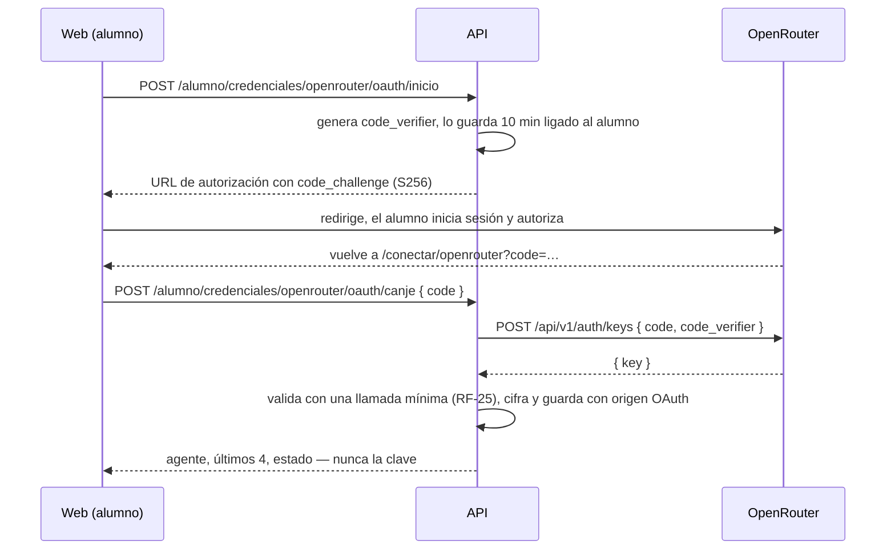

1. La API genera el `code_verifier`, lo guarda en caché 10 minutos ligado al alumno autenticado y devuelve la URL `https://openrouter.ai/auth` con `callback_url`, `code_challenge`, `code_challenge_method=S256` y `key_label` ("Tutor Pre-Clase").
2. El alumno inicia sesión en OpenRouter (con Google, GitHub o correo; si no tiene cuenta la crea ahí) y autoriza. OpenRouter vuelve a la web con `code`.
3. La web entrega el `code` a la API, que lo canjea junto con el `code_verifier` de **ese** alumno. Un código ajeno o vencido falla porque no tiene verificador que lo acompañe; el verificador se borra tras el primer intento.
4. La clave se valida contra OpenRouter (RF-25), se cifra y se guarda; la web solo ve el agente, los últimos 4 caracteres, el estado y la fecha (RF-26). Se puede reconectar o desconectar con un clic; al desconectar, el historial de sus conversaciones se conserva. Al desconectarla, la API la borra de la bóveda y la web recuerda que también puede revocarla en su cuenta de OpenRouter.
5. El modelo lo fija el administrador (una variante `:free` que haya pasado la suite de paridad); el alumno no elige modelo ni toca su configuración de privacidad: cada llamada pide a OpenRouter solo proveedores que no guardan los datos (RNF-11).

Ya conectado:

1. Al iniciar el examen el modelo queda fijado en el `Intento` (proveedor y modelo), para que la experiencia sea consistente y auditable (RF-06).
2. Si el proveedor falla (timeout, error 5xx, saturación o cupo), el chat ofrece **Reintentar**: reenvía el mismo mensaje sin volver a escribirlo y sin duplicarlo (el servidor no guarda dos veces un mensaje que quedó sin respuesta). El avance no se pierde: el historial y las respuestas viven en nuestra base de datos, no en el proveedor (RF-17).
3. Si OpenRouter rechaza la credencial (401/403) — por ejemplo, porque el alumno la revocó —, se marca *Invalida* y el chat vuelve a mostrar el botón para reconectar (RF-28); el avance del intento no se pierde.
4. Si corta por límite de uso (429), la credencial sigue *Valida*: el chat dice cuándo puede volver (cabecera `Retry-After` o `X-RateLimit-Reset` si viene) y que su avance está guardado (RF-30). Es lo esperable al agotar el cupo diario gratuito.

## 5.2 Examen conversacional

**Cada alumno rinde un examen propio, generado por la IA** (RF-04). Toda clase de la carpeta tiene su examen publicado (6 preguntas, 20 minutos, 3 intentos, **sin fechas**: el alumno lo rinde cuando quiera y no cierra nunca; la fecha de la clase es solo informativa); lo que no existe de antemano son las preguntas:

1. Al pulsar *Comenzar examen*, el servidor comprueba los intentos (RF-08) y que la clase tenga material.
2. **Pregunta a pregunta.** Con la cuenta de IA del alumno (Gemini u OpenRouter), pide a la IA **solo la primera pregunta**, de opción múltiple y basada únicamente en el material original de la clase: de comprensión y aplicación, con alternativas incorrectas plausibles y una justificación que cite `[archivo, p. N]`. Así el alumno empieza en segundos, en lugar de esperar a que la IA arme las seis. Es una llamada aparte del chat: la clave de respuestas nunca entra en la conversación del tutor (§6.4).
3. El intento se crea con `preguntas_planeadas` = las del examen (6 por defecto) y la primera pregunta ligada a él (`pregunta.intento_id`).
4. **La siguiente se prepara mientras responde.** Cada vez que el tutor entrega una pregunta, `PreparadorPreguntas` pide la siguiente en segundo plano, con la lista de lo ya preguntado para no repetir tema ni concepto. Cuando el tutor llama a `obtener_siguiente_pregunta`, casi siempre ya está lista; si no, `PreguntasDelIntento` la genera en ese momento. Un candado por intento evita que ambos caminos generen la misma pregunta, y nunca hay más de una preparada por delante (no se gasta cupo de más).
5. El servidor descarta las preguntas mal formadas (no 4 alternativas, más o menos de una correcta, repetidas) y baraja las alternativas para que la correcta no caiga siempre en la misma letra. Nadie las aprueba.
6. Si la IA falla con la primera, el intento **no se crea ni se consume** y el alumno puede reintentar. Si falla con una siguiente, **el reloj del intento se detiene** (`intento.pausado_desde`) hasta que la pregunta llega: ese tiempo de espera no se le descuenta, y la cabecera muestra el tiempo restante con la marca *en pausa*. Además, el tutor lo dice y la vuelve a pedir cuando el alumno lo indique: las respuestas ya registradas no se pierden. Una credencial rechazada o un límite de uso se tratan como en el chat (RF-28, RF-30).
7. Cada intento genera preguntas nuevas: repetir el examen no es memorizarlo. El mismo alumno no puede responder preguntas de otro intento, ni de otro alumno.

Con el examen listo, la conversación sigue igual:

1. El agente llama a `obtener_siguiente_pregunta` y **el servidor presenta la pregunta**: escribe en el chat el enunciado y las alternativas A–D tal como están guardados (`GuionExamen`). El modelo no las redacta ni las repite, así que no puede reformularlas ni inventar una.
2. El alumno responde en lenguaje natural ("creo que es la B", "ReLU"); el agente identifica la alternativa y, si hay ambigüedad, pide confirmación. Con la alternativa clara llama a `registrar_respuesta`; desde ese momento la respuesta es inmutable.
3. **Una letra sola no espera al modelo.** Si el mensaje es solo una alternativa ("B", "la c", "creo que es la A") y la pregunta está a la vista, la registra el servidor directamente: el progreso es inmediato (RNF-01) y no gasta cupo.
4. Tras registrar, el servidor escribe "Registrada." y entrega la siguiente pregunta. Con feedback *Inmediato*, antes el agente explica la corrección que devuelve la herramienta.
5. **El servidor cierra el examen** al registrar la última respuesta: califica, pasa el chat a Revisión y le entrega el resultado al agente para la evaluación final (§5.4). El agente solo puede llamar a `finalizar_examen` con preguntas pendientes si el alumno pidió terminar o se acabó el tiempo.
6. La lista de clases le muestra al alumno cómo va en cada examen: los intentos usados del tope de la clase, también antes de rendir (`0 de 3 intentos`), y su mejor nota (`Nota 16.7 · 2 de 3 intentos`); al agotarlos, la etiqueta dice *Sin intentos disponibles* y desaparece el botón *Comenzar examen*.
7. Si el alumno pide la respuesta, pistas o una explicación durante el examen, el agente se niega en una línea. Con feedback *AlFinal* el material no viaja en el prompt del examen: no tiene de dónde citar una pista.
7. No hay formularios ni botones de alternativas: la respuesta siempre entra como texto del chat.
8. **Lo que dice el modelo se comprueba antes de mostrarlo** (§6.4): durante el examen su texto no se emite en vivo. Si afirma que registró sin haber llamado a la herramienta, presenta una pregunta por su cuenta o cita el material antes de registrar, se descarta y se le pide de nuevo; si insiste, responde el servidor ("escribe la letra de la alternativa…") y no se registra nada.

## 5.3 Calificación

Al registrar la última respuesta (o si el alumno pide terminar antes, o vence el tiempo) el servidor cierra el intento y calcula la nota; el agente solo la comunica, nunca la calcula. El total son las **preguntas planeadas** del intento, no solo las generadas: si el alumno termina antes, las que faltaban cuentan como no acertadas. La IA no califica: comparar la alternativa elegida con la correcta es exacto, no se puede negociar con el modelo y no gasta cupo.

```latex
\text{nota} = \operatorname{round}\left(20 \times \frac{\text{correctas}}{\text{total}},\ 1\right)
```

## 5.4 Revisión como tutor

**Evaluación final de la IA.** Al terminar el examen, el tutor abre la revisión con una evaluación breve (máximo 120 palabras):
1. la nota del servidor;
2. lo que el alumno dominó, según las preguntas acertadas;
3. los temas a reforzar, según los fallos;
4. una recomendación concreta para llegar mejor a la clase.

Luego llama a `proponer_diagnostico` con esos temas, que alimentan el nivel y el reporte del docente (RF-21, RF-22), y ofrece repasar los fallos uno por uno. La nota no la toca: esa evaluación es cualitativa.

1. `finalizar_examen` devuelve al agente la nota y, por cada pregunta fallada, la alternativa elegida, la correcta y su justificación con la cita al material.
2. El agente recorre los fallos uno por uno: por qué la elección es incorrecta, qué concepto faltó (citando el material de la clase como [archivo, p. N]) y una pregunta corta de comprobación.
3. Tras cada fallo pregunta si el alumno quiere más detalle; las repreguntas se responden primero con el contenido de la clase.
4. Si el material no cubre la duda, el agente lo dice, amplía con su propio conocimiento marcándolo (sección 5.5) y la duda queda registrada para el docente (RF-13).
5. La nota y el detalle de fallos viven en el propio chat: el tutor los presenta al finalizar y los repite cuando el alumno los pide, siempre leyéndolos del servidor.

## 5.5 Consultas sobre el tema y ampliación

Fuera del examen el chat funciona como tutoría abierta de la clase (RF-19). El orden de respuesta es siempre el mismo:

1. **Primero el material del docente.** Si el contenido de la clase responde la pregunta, el tutor responde con él y cita `[archivo, p. N]`.
2. **Luego la ampliación.** Si el material no alcanza, el tutor lo dice de forma explícita y puede profundizar con su propio conocimiento, en un bloque marcado:

   > *Ampliación fuera del material:* … (no forma parte del contenido de la clase; confírmalo con tu docente)

3. **Siempre dentro del tema.** Si la pregunta no tiene relación con el curso, el tutor lo señala y reconduce la conversación; no es un asistente de propósito general.
4. Cada respuesta con ampliación marca `MensajeChat.usa_ampliacion` y registra la duda con `registrar_duda_sin_cobertura`, para que el docente vea qué tuvo que cubrir el tutor por su cuenta.

**Por defecto la ampliación está desactivada** (`ampliacion_permitida = false`): el tutor se limita al material de la clase. Solo se permite si el docente la activa en esa clase (RF-20), y nunca durante el examen (modo Evaluación). Desactivada, el tutor responde "Esto no está en el material de la clase; pregúntalo en la sesión" y no continúa.

## 5.6 Clasificación de nivel

El nivel es determinista y lo calcula el servidor; el tutor solo aporta el diagnóstico cualitativo, porque la nota es un dato objetivo y no debe depender del modelo.

| Nota vigente (mejor intento) | Nivel |
| --- | --- |
| 0 – 10,9 | Inicial |
| 11 – 14,9 | Básico |
| 15 – 17,9 | Intermedio |
| 18 – 20 | Avanzado |

1. Al finalizar un intento, `NivelService` calcula el nivel y lo guarda en `NivelAlumno` con origen *Automatico*.
2. En la revisión, el tutor llama a `proponer_diagnostico` con los temas donde vio vacíos (tomados de las preguntas falladas y de las repreguntas del alumno); eso llena `temas_debiles` sin cambiar el nivel.
3. El docente puede corregir el nivel de un alumno a mano; queda con origen *Docente* y no lo pisa el cálculo automático.
4. En el siguiente intento, la IA ajustará la dificultad al nivel vigente (RF-23, aún no implementado).

## 5.7 Herramientas del agente

El agente nunca recibe la respuesta correcta antes de que el alumno responda: el servidor solo la entrega tras registrar (modo Inmediato) o tras finalizar (modo Al final). El servidor además rechaza cualquier herramienta que no corresponda al modo de la conversación.

| Herramienta | Modo | Qué hace | Devuelve |
| --- | --- | --- | --- |
| obtener_siguiente_pregunta | Evaluación | Siguiente pregunta pendiente del intento | Enunciado y alternativas A–D, sin la correcta |
| registrar_respuesta(pregunta_id, alternativa) | Evaluación | Guarda la respuesta del alumno | Inmediato: correcta o no + justificación; Al final: solo "registrada" |
| obtener_progreso | Evaluación | Estado del intento | Respondidas, total, tiempo restante |
| finalizar_examen | Evaluación | Cierra y califica el intento | Nota, correctas, total y detalle de fallos |
| obtener_resultado | Revisión | Relee la nota y el detalle cuando el alumno los pide | Nota, correctas, total y fallos |
| registrar_duda_sin_cobertura(texto, tema, con_ampliacion) | Revisión, Consulta | Registra una duda que el material no cubre | Confirmación de registro |
| proponer_diagnostico(temas_debiles) | Revisión | Aporta los temas flojos que observó | Confirmación; no modifica el nivel |

## 5.8 Capa multi-proveedor

Una interfaz común aísla al resto del sistema del proveedor; el prompt de sistema, las herramientas y el historial son los mismos para todos. La credencial no vive en el proveedor ni en la configuración: se resuelve por conversación, a partir del alumno dueño, y se pasa en cada llamada.

```csharp
public interface ILlmProvider
{
    string Id { get; }   // "openrouter", "gemini", "openai", "anthropic", "gemini-clave"
    IAsyncEnumerable<LlmEvento> StreamAsync(LlmSolicitud solicitud, CancellationToken ct);
}

public sealed record LlmSolicitud(
    string Modelo,
    string PromptSistema,
    IReadOnlyList<LlmMensaje> Mensajes,
    IReadOnlyList<DefinicionHerramienta> Herramientas,
    double Temperatura = 0.2,
    int? MaxTokens = null,          // null: sin tope (el chat)
    string? Razonamiento = null);   // "desactivado" | "bajo"; null usa el del agente

public abstract record LlmEvento;
public sealed record TextoParcial(string Texto) : LlmEvento;
public sealed record LlamadaHerramienta(string Id, string Nombre, JsonElement Argumentos) : LlmEvento;
public sealed record Fin(int TokensEntrada, int TokensSalida, bool CortadaPorTope = false) : LlmEvento;
```

| Agente en la web | Implementación | API | Nota |
| --- | --- | --- | --- |
| OpenRouter (gratis) | OpenRouterProvider | API de OpenRouter, formato de chat de OpenAI (function calling) | Hereda del adaptador `OpenAiProvider` con la ruta `/api/v1/chat/completions`; pide `provider.data_collection = deny` y `provider.sort = throughput`, envía el nivel de razonamiento y traduce el 429 a `LimiteDeUso` |
| Gemini (tu cuenta de Google) | GeminiProvider | API de Gemini (`/v1beta/models/{modelo}:streamGenerateContent?alt=sse`) con un token de acceso OAuth | La credencial guardada es el **refresh token**; `TokensGoogle` lo cambia por un acceso de una hora (en memoria, renovado antes de vencer). Traduce herramientas a `functionDeclarations` (limpiando el JSON Schema que Gemini no acepta), el historial a turnos `user`/`model` y el razonamiento a `thinkingBudget` (0 desactivado, 512 bajo). 401 o permiso insuficiente → reconectar; API desactivada en el proyecto → error de la plataforma (no invalida la credencial); 429 → `LimiteDeUso` |

```json
"Agentes": {
  "openrouter": {
    "Nombre": "OpenRouter (gratis)",
    "BaseUrl": "https://openrouter.ai",
    "Modelo": "qwen/qwen3.8-27b:free",
    "ModelosAlternativos": [ "google/gemma-4-31b-it:free", "nvidia/nemotron-3-super-120b-a12b:free" ],
    "Razonamiento": "desactivado",
    "Habilitado": true,
    "Conexion": "OAuth",
    "UrlAutorizacion": "https://openrouter.ai/auth",
    "UrlRetorno": "http://localhost:4200/conectar/openrouter"
  }
}
```

**Modelo saturado.** Los modelos `:free` se sirven desde un cupo compartido por todos sus usuarios, y a ciertas horas el proveedor responde 429 aunque el alumno no haya gastado nada (`limit_source: upstream_provider_shared_pool`). Por eso cada llamada lleva, además del modelo principal, una lista de respaldo (`models`, configurada en `Agentes:openrouter:ModelosAlternativos`): OpenRouter pasa al siguiente en la misma llamada, con las mismas preferencias de privacidad. Si todos están saturados, el chat dice que el modelo está saturado y que reintente en segundos, distinto del aviso de cupo propio agotado (RF-30); ninguno de los dos gasta intentos ni invalida la credencial.

**Latencia (RNF-02).** Los modelos `:free` que razonan piensan antes de escribir: ese razonamiento no se ve, retrasa el primer token y consume el tope de salida (con 1024 tokens había respuestas cortadas a media frase). Por eso:

- En el chat el razonamiento va **desactivado** (`Agentes:openrouter:Razonamiento`, que OpenRouter recibe como `reasoning.enabled = false`). La generación del examen pide razonamiento **bajo**: el alumno la espera una sola vez y la calidad de las preguntas pesa más.
- El chat **no pone tope de salida**: no se envía `max_tokens` (ni `maxOutputTokens` a Gemini), así que el modelo responde completo, hasta su propio máximo. Con 1024 había respuestas cortadas a media cita. Si aun así llega al máximo del modelo (`finish_reason: length` / `MAX_TOKENS`), el chat avisa *"La respuesta quedó incompleta… Pide al tutor que continúe"*. Generar el examen y condensar el material sí fijan un tope, calculado según lo que piden.
- Entre los proveedores que no guardan los prompts, OpenRouter elige el de más tokens por segundo (`provider.sort = throughput`).
- Cada llamada deja en el log el tiempo al primer token, el tiempo total, los tokens de entrada, salida y razonamiento, y el modelo que respondió, sin texto del alumno (RNF-06).

El administrador puede cambiar el modelo `:free` sin desplegar, pero solo por uno que haya pasado la suite de paridad: no todos los modelos gratuitos soportan herramientas, y sin herramientas no hay examen. OpenRouter también sirve modelos de pago (Claude, GPT…); habilitarlos no cambia nada en la plataforma, pero el consumo correría por la cuenta de cada alumno, que tendría que cargar saldo.

La configuración describe el proveedor y el modelo; no contiene claves. La de cada alumno vive cifrada en `credencial_agente`.

Orquestación en `AgenteTutorService`, por cada mensaje del alumno:

1. Carga la conversación con su modo, el intento asociado si lo hay, el proveedor elegido, la credencial del alumno dueño y los últimos 20 mensajes desde la base de datos.
2. Arma la `LlmSolicitud` con el prompt de sistema común (sección 6.3), el contexto de clase cacheado (sección 6.2) y solo las herramientas válidas para ese modo.
3. Reenvía cada `TextoParcial` al navegador por SSE en cuanto llega, también con la ampliación desactivada: `EmisorConCorte` retiene solo los últimos 64 caracteres, lo justo para contener la marca de ampliación aunque llegue partida, y si aparece deja de emitir y termina con el aviso estándar (sección 6.4). Ante una `LlamadaHerramienta` la ejecuta en el servidor, agrega el resultado y vuelve a llamar (máximo 6 vueltas por mensaje).
4. Aplica los cortes de la sección 6.4 (ampliación no permitida, citas inválidas) antes de dar por buena la respuesta.
5. Guarda mensajes, llamadas a herramientas, marca de ampliación y tokens en `MensajeChat` para auditoría y control de costos.


Adaptadores por tipo de agente:

| Agente | Conexión | Adaptador | Ruta del chat | Credencial |
| --- | --- | --- | --- | --- |
| `openrouter` | OAuth | `OpenRouterProvider` | `/api/v1/chat/completions` | Clave obtenida por OAuth, `Bearer` |
| `gemini` | OAuth de Google | `GeminiProvider` | `streamGenerateContent` (formato propio) | Refresh token → acceso, `Bearer` |
| `openai` | Clave | `OpenAiProvider` | `https://api.openai.com/v1/chat/completions` | Clave del alumno, `Bearer` |
| `anthropic` | Clave | `OpenAiProvider` | `https://api.anthropic.com/v1/chat/completions` (compatibilidad OpenAI) | Clave del alumno, `Bearer` |
| `gemini-clave` | Clave | `OpenAiProvider` | `https://generativelanguage.googleapis.com/v1beta/openai/chat/completions` | Clave de AI Studio, `Bearer` |

Los tres de tipo *Clave* comparten el adaptador en formato OpenAI; cada agente aporta su `RutaChat` y, si el proveedor lo admite, el `reasoning_effort` para apagar el razonamiento en el chat (OpenAI: `minimal`). La validación previa (RF-25) usa una llamada que no gasta cupo: `GET /v1/models` con `Bearer` (OpenAI), con `x-api-key` y `anthropic-version` (Anthropic), o `GET /v1beta/models` con `x-goog-api-key` (AI Studio).

## 5.9 Arquitectura con OpenRouter y flujos de extremo a extremo

> OpenRouter está retirado (ver la nota de §5.1). Los flujos 1 a 4 valen igual con cualquier IA conectada: donde dicen OpenRouter, hoy responde Gemini o el proveedor de la clave del alumno.

Esta sección reúne cómo usa la plataforma a OpenRouter y a Gemini en toda la app, y los flujos que los atraviesan. Describe la implementación v1 desplegada (Railway y Vercel). Las secciones 3 y 6 fijan el diseño de referencia.

### Por qué OpenRouter y por qué un modelo `:free`

- **Un solo gateway para muchos modelos.** OpenRouter expone modelos de muchos proveedores (Qwen, Google, NVIDIA, OpenAI, Anthropic…) con el mismo formato de chat de OpenAI. Cambiar de modelo es configuración (`Agentes:openrouter:Modelo` o `PUT /admin/agentes/{id}`), no código.
- **Cada alumno usa su propia cuenta (BYOK).** La conecta con un clic por OAuth con PKCE (§5.1). La plataforma no guarda una clave compartida ni paga por los alumnos. La clave se guarda cifrada y solo se usa en las conversaciones de su dueño.
- **Gratis por defecto.** El administrador elige una variante `:free` (hoy `qwen/qwen3.8-27b:free`) que soporte herramientas y haya pasado la suite de paridad. El alumno no paga ni configura nada.
  - El costo son los límites del plan gratuito: un cupo diario por cuenta y un pool compartido que a ciertas horas se satura (429 `upstream_provider_shared_pool`).
  - Por eso cada llamada lleva modelos de respaldo, y el chat distingue *modelo saturado* de *cupo agotado* (RF-30).
- **Cada usuario puede usar su cuenta de Google con Gemini (RF-37).** Es el único gran proveedor que acepta OAuth para que una app llame a su IA en nombre del usuario (scopes `cloud-platform` y `generative-language.retriever`; con solo el primero la API responde 403 "insufficient authentication scopes"). Condición de Google: los límites de la API de Gemini son **por proyecto de Google Cloud, no por usuario**. Con OAuth, Google identifica al alumno por su Gmail, pero el uso cuenta contra el plan gratuito del proyecto de la app (`tutor-pre-clase`), salvo que el alumno indique un proyecto propio (`x-goog-user-project`, fase 2). Si el piloto crece, se activa facturación en ese proyecto.
- **ChatGPT y Claude no tienen versión gratuita en la API.** Las suscripciones ChatGPT Plus o claude.ai Pro tampoco la habilitan. OpenRouter sí sirve esos modelos de pago (`openai/…`, `anthropic/…`): habilitarlos es cambiar el modelo, sin tocar código. El consumo, en cambio, corre por la cuenta de quien pague:

| Opción | Quién paga | Ventaja | Costo para el diseño |
| --- | --- | --- | --- |
| **`:free` (v1, vigente)** | Nadie | El alumno entra sin tarjeta | Saturación en horas pico, cupo diario, calidad variable |
| Modelo de pago con la cuenta del alumno | Cada alumno carga saldo en OpenRouter | Rápido y sin saturación; la app no cambia | Fricción: tarjeta y recargas por alumno |
| Modelo de pago con clave institucional | La universidad | La mejor experiencia | Rompe el BYOK: hace falta una clave compartida en el servidor, topes por alumno (RNF-08) y aprobación del envío de datos a Anthropic u OpenAI |

Antes de habilitar cualquier modelo, gratuito o de pago, se pasa la suite de paridad (§9.2), y se revisa dónde se procesan los datos (RNF-11).

### Parámetros de cada llamada

| Parámetro | Chat (Consulta, Revisión, Evaluación) | Generación del examen | Condensación del material |
| --- | --- | --- | --- |
| `model` / `models` | Modelo del agente y, detrás, los `ModelosAlternativos`: OpenRouter pasa al siguiente si uno falla o está saturado | Igual | Igual |
| `provider` | `data_collection: deny` (solo proveedores que no guardan los prompts, RNF-11) y `sort: throughput` (el más rápido) | Igual | Igual |
| `reasoning` | `enabled: false`: el primer token llega antes y el razonamiento no consume el tope | `effort: low`: se espera una vez y pesa la calidad de las preguntas | `enabled: false` |
| `max_tokens` | Sin tope (no se envía): el modelo responde completo; si llega a su propio máximo se avisa *respuesta incompleta* | 600 × N + 400 | Tokens del lote + 400 |
| `temperature` | 0.2 | 0.7 (cada intento, un examen distinto) | 0.1 (fiel al texto) |
| `tools` | Solo las del modo (§5.7) | Ninguna | Ninguna |
| Material | Apuntes condensados donde los hay; en Consulta y Revisión de una clase grande, solo las páginas pertinentes (§6.2) | Siempre el **original** completo | Lotes de páginas seguidas, hasta 3000 tokens de original por llamada |
| `stream` | Sí, reenviado al navegador por SSE mientras llega | Sí, acumulado en el servidor | Sí, acumulado en el servidor |
| Credencial | `Authorization: Bearer <clave del alumno>`, descifrada solo para esta llamada | Igual | La del **profesor** del curso |

Cada llamada deja en el log el modelo que respondió, el tiempo al primer token, el tiempo total y los tokens de entrada, salida y razonamiento, sin texto del alumno (RNF-06).

### Componentes

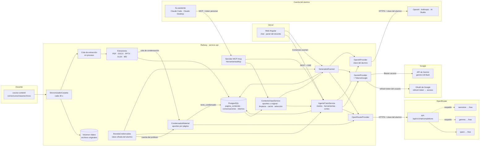

### Flujo 1: el profesor sube material

El profesor no usa formularios: copia el archivo en su carpeta (§6.1). En producción la carpeta viaja en la imagen de la API, así que subir material es hacer commit en `course-content/` y dejar que el CD despliegue.

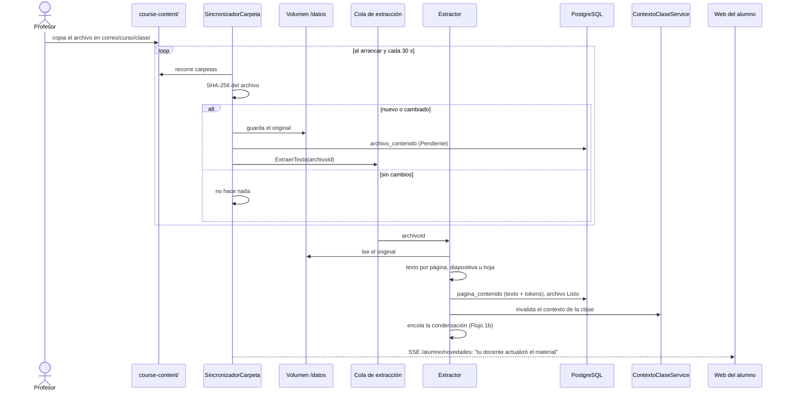

El texto se extrae **una sola vez**, al subir. Ninguna pregunta del alumno vuelve a leer un documento.

### Flujo 1b: la IA condensa el material (RF-36)

Justo después de extraer el texto, en segundo plano y una sola vez por archivo, la IA reescribe cada página como apuntes compactos. Mientras tanto, o si no se puede, el tutor lee el original: nada espera a la condensación.

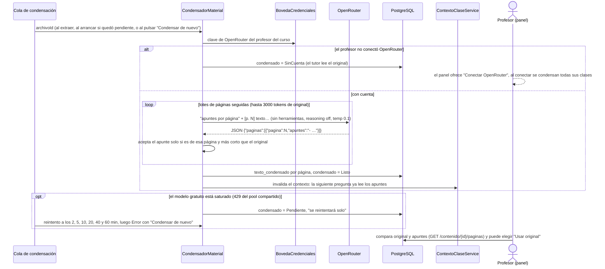

Una página de menos de 60 tokens ya es un apunte y no se condensa. Una página que la IA no devuelve, o devuelve más larga, se queda con su original. Si el texto del archivo cambia, sus apuntes se borran y se rehacen.

### Flujo 2: se prepara el material para la IA

Es el "archivo" que realmente recibe el modelo: el bloque `<contenido>` de la clase. Hay dos versiones en caché por clase: la del tutor, con los apuntes condensados donde los hay, y la original, para generar el examen. Cada una se arma una vez y se rehace cuando cambia el material, sus apuntes o la elección del profesor.

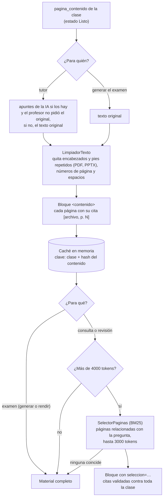

### Flujo 3: el alumno consulta al agente

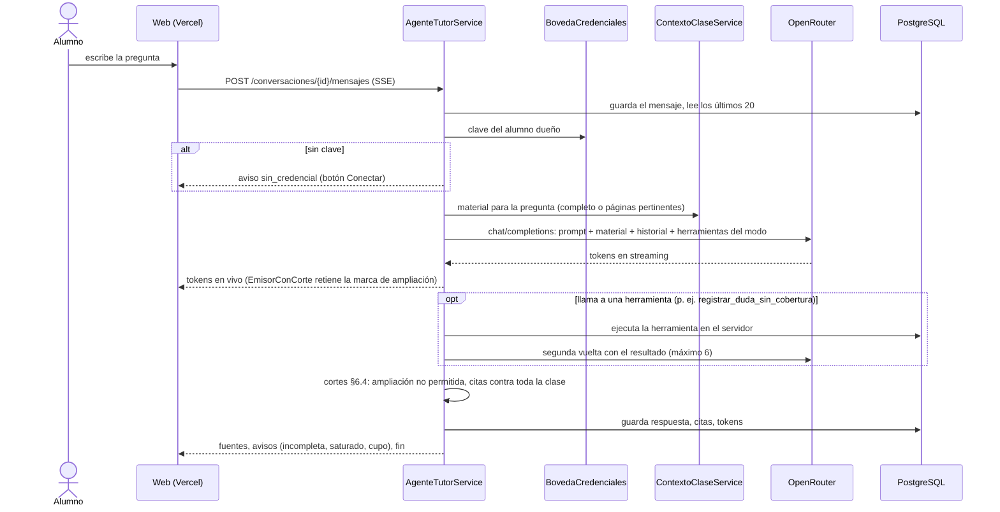

Si OpenRouter responde 429 o 401, no se reintenta a ciegas:
- 429 del pool compartido: *modelo saturado, reintenta en segundos*;
- 429 del cupo propio: *podrás seguir en N min*;
- 401 o 403: la credencial se marca inválida y el chat pide reconectarla.

En ningún caso se pierde el avance.

### Flujo 4: se genera el examen del alumno

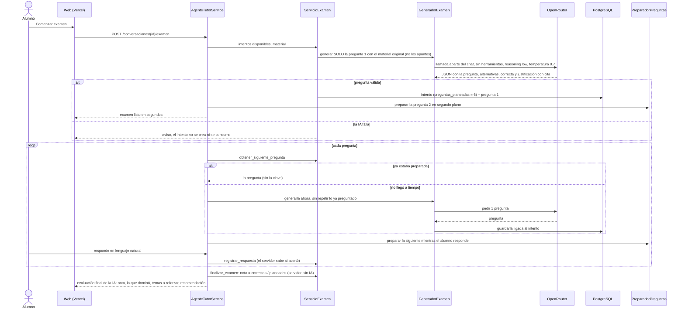

Rendir el examen es el mismo Flujo 3 en modo Evaluación, con dos diferencias:
- el agente solo tiene `obtener_siguiente_pregunta`, `registrar_respuesta`, `obtener_progreso` y `finalizar_examen`;
- la clave de respuestas nunca entra en su contexto.

La calificación la hace el servidor, sin IA (§5.3); la evaluación cualitativa del final la hace la IA (§5.4).

### Flujo 5: el usuario conecta Gemini con su cuenta de Google (RF-37)

El mismo cliente OAuth web del inicio de sesión, con un permiso más. El refresh token no pasa nunca por el navegador.

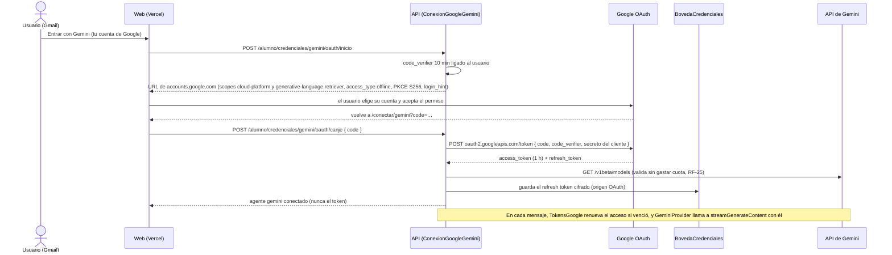

Si el usuario revoca el acceso en su cuenta de Google, la renovación responde `invalid_grant`: la credencial se marca inválida y el chat pide reconectar (RF-28). Si la API de Gemini no está activada en el proyecto, el error es de la plataforma y la credencial del usuario sigue válida.

### Flujo 6: el alumno conecta su clave de API (RF-38)

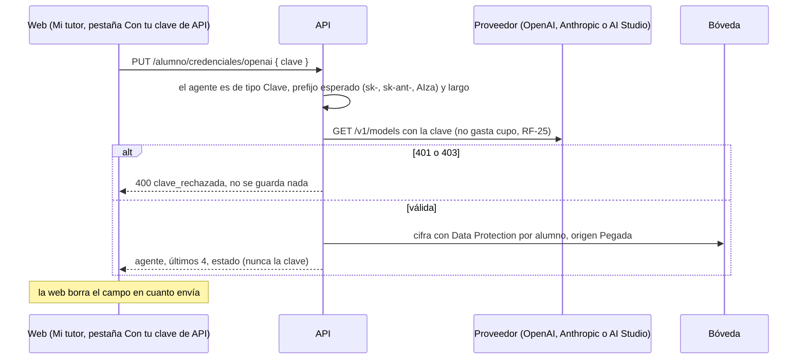

En cada mensaje la API descifra la clave solo para la llamada saliente y usa `OpenAiProvider` con la ruta del proveedor (§5.8). Un 401 posterior la marca inválida y *Mi tutor* pide pegar una nueva (RF-28).

### Flujo 7: el alumno estudia desde su asistente (RF-39)

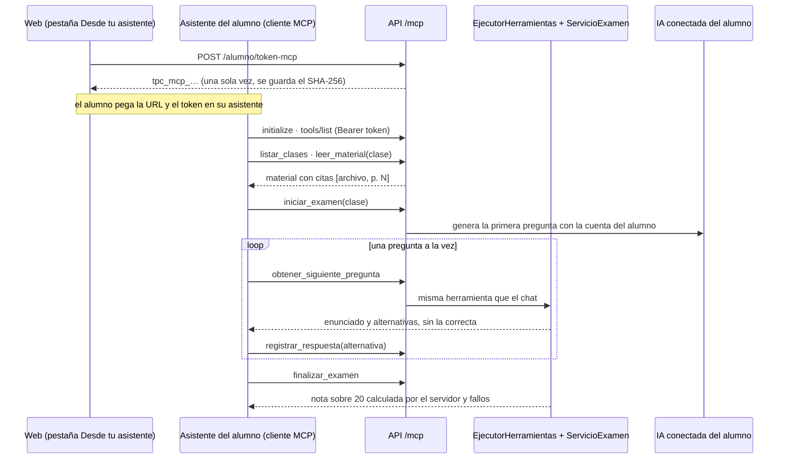

El asistente nunca recibe la clave de respuestas antes de finalizar ni puede escribir la nota: las herramientas son las del chat y pasan por el mismo `EjecutorHerramientas`, que comprueba el modo y los intentos. El servidor MCP envía como instrucciones las reglas del tutor (§6.3): citar el material, marcar la ampliación y no dar pistas durante el examen. La sesión de la web no abre `/mcp`, y el token MCP no abre el resto de la API.

---

[← 4. Modelo de datos](04-modelo-de-datos.md) · [Índice del SDD](SDD-Plataforma-Evaluacion-PreClase.md) · [6. Módulo de contenido de clase →](06-contenido-de-clase.md)
