# 5. Flujos principales con el agente tutor

[← 4. Modelo de datos](04-modelo-de-datos.md) · [Índice del SDD](SDD-Plataforma-Evaluacion-PreClase.md) · [6. Módulo de contenido de clase →](06-contenido-de-clase.md)

Todo ocurre en un solo chat por clase. El `AgenteTutorService` es el intermediario: recibe el mensaje del alumno, decide en qué **modo** está la conversación y arma la llamada al proveedor con el contenido del docente, las herramientas permitidas y las reglas de ese modo.

| Modo | Cuándo | Qué puede hacer el tutor |
| --- | --- | --- |
| Consulta | Antes del examen, o después de cerrada la revisión | Responder dudas del tema con el material; ampliar marcando la ampliación |
| Evaluación | Examen en curso | Solo presentar preguntas y registrar respuestas; sin pistas, sin explicaciones, sin ampliación |
| Revisión | Tras finalizar el examen | Comunicar la nota, explicar cada fallo, responder repreguntas y ampliar marcando |

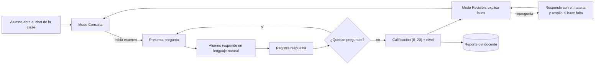

*Flujo en modo Al final.* En modo *Inmediato* el tutor explica cada error apenas se registra la respuesta; en modo *Al final* (por defecto) espera al cierre del examen para no influir en las respuestas siguientes. El docente elige el modo por examen.

## 5.0 Inicio de sesión y rol

Todos entran por la misma página (RF-31). **Primero eligen el perfil** (*Soy alumno* / *Soy profesor*) y después entran con *Continuar con Google*:

1. La web pide a la API la URL del proveedor con el perfil elegido (`POST /acceso/{proveedor}/inicio { perfil }`); la API genera `state`, `nonce` y el verificador PKCE y los guarda 10 minutos **junto con el perfil**, que así no viaja por la URL ni se puede alterar al volver.
2. La persona inicia sesión en Google y vuelve a `/entrar/{proveedor}?code=…&state=…`.
3. La API canjea el código directamente con el proveedor (por TLS, con su secreto de cliente) y valida el `id_token`: emisor, audiencia, vigencia, `nonce` y correo verificado.
4. Busca al usuario por ese correo (RF-33):
   - Ya registrado: entra con el perfil elegido. Un **profesor puede entrar como alumno** (la sesión lleva rol Alumno y `vistas: [Docente, Alumno]`): ve el chat, elige profesor —incluido él mismo— y conserva sus propios cursos. Un **alumno que entra como profesor pasa a ser profesor** (y puede seguir entrando como alumno). Un profesor cuya carpeta ya existía quedó registrado por el sincronizador con su correo; al entrar se toma su nombre.
   - Correos de `Acceso:Administradores`: entran como administrador.
   - Primera vez, con `Acceso:RegistroAbierto = true` (por defecto): como **profesor**, se crea y entra directo; como **alumno**, el canje no crea a nadie y devuelve un **registro pendiente** (token de un solo uso, 10 min) para que elija a su profesor de la lista (`GET /acceso/profesores`, con los cursos de cada uno); `POST /acceso/registro` crea al usuario y emite la sesión. Nadie puede elegirse administrador.
   - Con el registro cerrado, quien no está registrado no entra (403 `no_registrado`).

   Las matrículas se derivan del profesor: el profesor está en los cursos de su carpeta y el alumno, exactamente en los cursos de su profesor. Si el alumno cambia de profesor (`PUT /alumno/profesor`), deja de ver los del anterior (sus intentos se conservan); si el profesor añade un curso a su carpeta, la siguiente sincronización matricula a todos sus alumnos.
5. La API emite su propia sesión (JWT firmado por ella, 12 h) con el rol que el usuario tiene **en la plataforma**, no en el proveedor. La web la envía como `Authorization: Bearer` y lleva a cada rol a su pantalla: el alumno al chat, el docente a su panel y el administrador a la gestión de usuarios.
6. **Alumno sin IA conectada (RF-32):** tras entrar, la web le abre *Mi tutor* (§5.1) en la pestaña *Con tu clave de API*. No se le reenvía solo a ningún proveedor: elige él cómo conectarla, y mientras no conecte ninguna el chat no deja escribir.

La página solo ofrece OAuth, con un único botón: *Continuar con Google*, igual para alumno y profesor. La entrada con Microsoft (Outlook) se retiró; el canje es OIDC genérico y la web pinta un botón por cada proveedor de la configuración de la API, así que volver a ofrecerlo es añadirlo ahí. Si el proveedor no tiene `ClientId`, el botón avisa que no está configurado. Fuera de producción, la API mantiene `/acceso/desarrollo` para las pruebas automáticas y por `curl`, pero la web no lo muestra.

## 5.1 Conexión del agente

Antes de conversar, cada usuario conecta **su propia IA** en *Mi tutor* (§8). Hay tres formas, una por pestaña; puede tener varias conectadas y elige con cuál conversa en «Conversas con» (RF-37). El profesor usa las mismas para que la IA condense su material (RF-36).

| Pestaña | Cómo | Agentes | Quién paga |
| --- | --- | --- | --- |
| **Con tu clave de API** (se abre por defecto) | Pega su clave; se valida y se cifra (RF-38, Flujo 6 de §5.9) | Gemini (AI Studio, `gemini-clave`), ChatGPT (`openai`), Claude (`anthropic`) | El cupo gratuito de su cuenta de AI Studio, o su cuenta de desarrollador de OpenAI o Anthropic |
| **Con tu cuenta** | Inicia sesión en Google y acepta un permiso (OAuth con PKCE, RF-37, Flujo 5) | Gemini (`gemini`) | El plan gratuito del proyecto de Google de la plataforma |
| **Desde tu asistente** | Token personal para su cliente MCP (RF-39, Flujo 7) | Su propio asistente usa el Tutor como herramienta | Su suscripción del asistente; las preguntas del examen las genera la IA conectada en las otras pestañas |

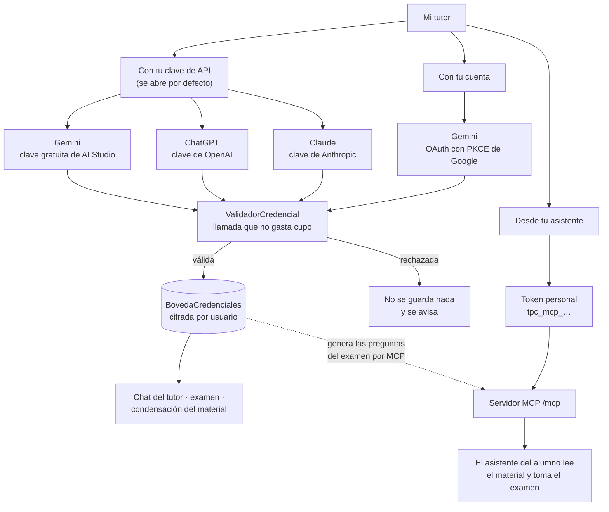

Reglas comunes a las dos primeras formas:

1. **La clave de API gratuita de Gemini es la vía principal.** Se crea en Google AI Studio con cualquier Gmail, sin tarjeta; la pestaña trae los pasos. La conexión por cuenta de Google pide un permiso sensible y, mientras Google no verifique la aplicación, solo funciona con las cuentas dadas de alta como usuarios de prueba: a las demás Google les muestra «Acceso bloqueado» y la pestaña lo avisa (§9.6).
2. **Toda credencial se valida antes de guardarse** (RF-25) con una llamada que no gasta cupo (listar modelos). Si el proveedor la rechaza, se avisa y no se guarda nada.
3. **Se guarda cifrada y nunca se devuelve** (RF-26): la web solo ve el agente, los últimos 4 caracteres, el origen (`Pegada` u `OAuth`), el estado y la fecha. Con Google lo que se guarda es el *refresh token*, que no pasa nunca por el navegador.
4. **Cada agente admite una sola forma** (RF-29): `gemini` solo se conecta por OAuth (pegarle una clave responde 400 `conexion_por_oauth`) y los de tipo *Clave* solo aceptan una clave con la forma de su proveedor (`sk-` en OpenAI, `sk-ant-` en Anthropic; Gemini no fija prefijo porque Google cambió el formato de sus claves).
5. **Reconectar o desconectar es un clic.** Al desconectar, la API borra la credencial de la bóveda y el historial de las conversaciones se conserva. Un agente que el administrador retira (`Habilitado: false`) deja de listarse y de poder conectarse, aunque queden cuentas guardadas.
6. **El modelo lo fija el administrador** por agente (RF-35); el alumno elige con qué cuenta conversa, no el modelo.

Sin ninguna IA conectada el chat no deja escribir y se abre *Mi tutor* (RF-27, RF-32).

Ya conectado:

1. Al iniciar el examen el agente y su modelo quedan fijados en el `Intento`, para que la experiencia sea consistente y auditable (RF-06); durante el examen no se puede cambiar de IA.
2. Si el proveedor falla (timeout, error 5xx, saturación o cupo), el chat ofrece **Reintentar**: reenvía el mismo mensaje sin volver a escribirlo y sin duplicarlo (el servidor no guarda dos veces un mensaje que quedó sin respuesta). El avance no se pierde: el historial y las respuestas viven en nuestra base de datos, no en el proveedor (RF-17).
3. Si el proveedor rechaza la credencial (401/403) — por ejemplo, porque el alumno revocó la clave o el permiso de Google —, se marca *Invalida* y *Mi tutor* pide volver a entrar o pegar una clave nueva (RF-28); el avance del intento no se pierde.
4. Si corta por límite de uso (429), la credencial sigue *Valida*: el chat dice cuándo puede volver (cabecera `Retry-After`, o el plazo que trae el error de Gemini) y que su avance está guardado (RF-30). Es lo esperable al agotar el cupo gratuito.
5. Si el modelo está saturado para todos (503 de Gemini), el chat lo dice así —no es el cupo del alumno— y basta reintentar en segundos.
6. Si la cuenta de pago no tiene saldo (OpenAI responde 429 `insufficient_quota`; Anthropic, 400 por créditos), la clave es buena pero no hay nada que esperar: el chat pide cargar saldo o conversar con otra IA.

## 5.2 Examen conversacional

**Cada alumno rinde un examen propio, generado por la IA** (RF-04). Toda clase de la carpeta tiene su examen publicado (6 preguntas, 20 minutos, 3 intentos, **sin fechas**: el alumno lo rinde cuando quiera y no cierra nunca; la fecha de la clase es solo informativa); lo que no existe de antemano son las preguntas:

1. Al pulsar *Comenzar examen*, el servidor comprueba los intentos (RF-08) y que la clase tenga material.
2. **Pregunta a pregunta.** Con la IA que el alumno tiene en uso (la del chat de esa clase), pide a la IA **solo la primera pregunta**, de opción múltiple y basada únicamente en el material original de la clase: de comprensión y aplicación, con alternativas incorrectas plausibles y una justificación que cite `[archivo, p. N]`. Así el alumno empieza en segundos, en lugar de esperar a que la IA arme las seis. Es una llamada aparte del chat: la clave de respuestas nunca entra en la conversación del tutor (§6.4).
3. El intento se crea con `preguntas_planeadas` = las del examen (6 por defecto) y la primera pregunta ligada a él (`pregunta.intento_id`).
4. **La siguiente se prepara mientras responde.** Cada vez que el tutor entrega una pregunta, `PreparadorPreguntas` pide la siguiente en segundo plano, con la lista de lo ya preguntado para no repetir tema ni concepto. Cuando el tutor llama a `obtener_siguiente_pregunta`, casi siempre ya está lista; si no, `PreguntasDelIntento` la genera en ese momento. Un candado por intento evita que ambos caminos generen la misma pregunta, y nunca hay más de una preparada por delante (no se gasta cupo de más).
5. El servidor descarta las preguntas mal formadas (no 4 alternativas, más o menos de una correcta, repetidas) y baraja las alternativas para que la correcta no caiga siempre en la misma letra. Nadie las aprueba.
6. Si la IA falla con la primera, el intento **no se crea ni se consume** y el alumno puede reintentar. Si falla con una siguiente, **el reloj del intento se detiene** (`intento.pausado_desde`) hasta que la pregunta llega: ese tiempo de espera no se le descuenta, y la cabecera muestra el tiempo restante con la marca *en pausa*. Además, el tutor lo dice y la vuelve a pedir cuando el alumno lo indique: las respuestas ya registradas no se pierden. Una credencial rechazada o un límite de uso se tratan como en el chat (RF-28, RF-30).
7. Cada intento genera preguntas nuevas: repetir el examen no es memorizarlo. El mismo alumno no puede responder preguntas de otro intento, ni de otro alumno.

Con el examen listo, la conversación sigue igual:

1. El agente llama a `obtener_siguiente_pregunta` y **el servidor presenta la pregunta**: escribe en el chat el enunciado y las alternativas A–D tal como están guardados (`GuionExamen`). El modelo no las redacta ni las repite, así que no puede reformularlas ni inventar una.
2. El alumno responde en lenguaje natural ("creo que es la B", "ReLU"); el agente identifica la alternativa y, si hay ambigüedad, pide confirmación. Con la alternativa clara llama a `registrar_respuesta`; desde ese momento la respuesta es inmutable.
3. **Una letra sola no espera al modelo.** Si el mensaje es solo una alternativa ("B", "la c", "creo que es la A") y la pregunta está a la vista, la registra el servidor directamente: el progreso es inmediato (RNF-01) y no gasta cupo.
4. Tras registrar, el servidor escribe "Registrada." y entrega la siguiente pregunta. Con feedback *Inmediato*, antes el agente explica la corrección que devuelve la herramienta.
5. **El servidor cierra el examen** al registrar la última respuesta: califica, pasa el chat a Revisión y le entrega el resultado al agente para la evaluación final (§5.4). El agente solo puede llamar a `finalizar_examen` con preguntas pendientes si el alumno pidió terminar o se acabó el tiempo.
6. La lista de clases le muestra al alumno cómo va en cada examen: los intentos usados del tope de la clase, también antes de rendir (`0 de 3 intentos`), y su mejor nota (`Nota 16.7 · 2 de 3 intentos`); al agotarlos, la etiqueta dice *Sin intentos disponibles* y desaparece el botón *Comenzar examen*.
7. Si el alumno pide la respuesta, pistas o una explicación durante el examen, el agente se niega en una línea. Con feedback *AlFinal* el material no viaja en el prompt del examen: no tiene de dónde citar una pista.
7. No hay formularios ni botones de alternativas: la respuesta siempre entra como texto del chat.
8. **Lo que dice el modelo se comprueba antes de mostrarlo** (§6.4): durante el examen su texto no se emite en vivo. Si afirma que registró sin haber llamado a la herramienta, presenta una pregunta por su cuenta o cita el material antes de registrar, se descarta y se le pide de nuevo; si insiste, responde el servidor ("escribe la letra de la alternativa…") y no se registra nada.

## 5.3 Calificación

Al registrar la última respuesta (o si el alumno pide terminar antes, o vence el tiempo) el servidor cierra el intento y calcula la nota; el agente solo la comunica, nunca la calcula. El total son las **preguntas planeadas** del intento, no solo las generadas: si el alumno termina antes, las que faltaban cuentan como no acertadas. La IA no califica: comparar la alternativa elegida con la correcta es exacto, no se puede negociar con el modelo y no gasta cupo.

```latex
\text{nota} = \operatorname{round}\left(20 \times \frac{\text{correctas}}{\text{total}},\ 1\right)
```

## 5.4 Revisión como tutor

**Evaluación final de la IA.** Al terminar el examen, el tutor abre la revisión con una evaluación breve (máximo 120 palabras):
1. la nota del servidor;
2. lo que el alumno dominó, según las preguntas acertadas;
3. los temas a reforzar, según los fallos;
4. una recomendación concreta para llegar mejor a la clase.

Luego llama a `proponer_diagnostico` con esos temas, que alimentan el nivel y el reporte del docente (RF-21, RF-22), y ofrece repasar los fallos uno por uno. La nota no la toca: esa evaluación es cualitativa.

1. `finalizar_examen` devuelve al agente la nota y, por cada pregunta fallada, la alternativa elegida, la correcta y su justificación con la cita al material.
2. El agente recorre los fallos uno por uno: por qué la elección es incorrecta, qué concepto faltó (citando el material de la clase como [archivo, p. N]) y una pregunta corta de comprobación.
3. Tras cada fallo pregunta si el alumno quiere más detalle; las repreguntas se responden primero con el contenido de la clase.
4. Si el material no cubre la duda, el agente lo dice, amplía con su propio conocimiento marcándolo (sección 5.5) y la duda queda registrada para el docente (RF-13).
5. La nota y el detalle de fallos viven en el propio chat: el tutor los presenta al finalizar y los repite cuando el alumno los pide, siempre leyéndolos del servidor.

## 5.5 Consultas sobre el tema y ampliación

Fuera del examen el chat funciona como tutoría abierta de la clase (RF-19). El orden de respuesta es siempre el mismo:

1. **Primero el material del docente.** Si el contenido de la clase responde la pregunta, el tutor responde con él y cita `[archivo, p. N]`.
2. **Luego la ampliación.** Si el material no alcanza, el tutor lo dice de forma explícita y puede profundizar con su propio conocimiento, en un bloque marcado:

   > *Ampliación fuera del material:* … (no forma parte del contenido de la clase; confírmalo con tu docente)

3. **Siempre dentro del tema.** Si la pregunta no tiene relación con el curso, el tutor lo señala y reconduce la conversación; no es un asistente de propósito general.
4. Cada respuesta con ampliación marca `MensajeChat.usa_ampliacion` y registra la duda con `registrar_duda_sin_cobertura`, para que el docente vea qué tuvo que cubrir el tutor por su cuenta.

**Por defecto la ampliación está desactivada** (`ampliacion_permitida = false`): el tutor se limita al material de la clase. Solo se permite si el docente la activa en esa clase (RF-20), y nunca durante el examen (modo Evaluación). Desactivada, el tutor responde "Esto no está en el material de la clase; pregúntalo en la sesión" y no continúa.

## 5.6 Clasificación de nivel

El nivel es determinista y lo calcula el servidor; el tutor solo aporta el diagnóstico cualitativo, porque la nota es un dato objetivo y no debe depender del modelo.

| Nota vigente (mejor intento) | Nivel |
| --- | --- |
| 0 – 10,9 | Inicial |
| 11 – 14,9 | Básico |
| 15 – 17,9 | Intermedio |
| 18 – 20 | Avanzado |

1. Al finalizar un intento, `NivelService` calcula el nivel y lo guarda en `NivelAlumno` con origen *Automatico*.
2. En la revisión, el tutor llama a `proponer_diagnostico` con los temas donde vio vacíos (tomados de las preguntas falladas y de las repreguntas del alumno); eso llena `temas_debiles` sin cambiar el nivel.
3. El docente puede corregir el nivel de un alumno a mano; queda con origen *Docente* y no lo pisa el cálculo automático.
4. En el siguiente intento, la IA ajustará la dificultad al nivel vigente (RF-23, aún no implementado).

## 5.7 Herramientas del agente

El agente nunca recibe la respuesta correcta antes de que el alumno responda: el servidor solo la entrega tras registrar (modo Inmediato) o tras finalizar (modo Al final). El servidor además rechaza cualquier herramienta que no corresponda al modo de la conversación.

| Herramienta | Modo | Qué hace | Devuelve |
| --- | --- | --- | --- |
| obtener_siguiente_pregunta | Evaluación | Siguiente pregunta pendiente del intento | Enunciado y alternativas A–D, sin la correcta |
| registrar_respuesta(pregunta_id, alternativa) | Evaluación | Guarda la respuesta del alumno | Inmediato: correcta o no + justificación; Al final: solo "registrada" |
| obtener_progreso | Evaluación | Estado del intento | Respondidas, total, tiempo restante |
| finalizar_examen | Evaluación | Cierra y califica el intento | Nota, correctas, total y detalle de fallos |
| obtener_resultado | Revisión | Relee la nota y el detalle cuando el alumno los pide | Nota, correctas, total y fallos |
| registrar_duda_sin_cobertura(texto, tema, con_ampliacion) | Revisión, Consulta | Registra una duda que el material no cubre | Confirmación de registro |
| proponer_diagnostico(temas_debiles) | Revisión | Aporta los temas flojos que observó | Confirmación; no modifica el nivel |

## 5.8 Capa multi-proveedor

Una interfaz común aísla al resto del sistema del proveedor; el prompt de sistema, las herramientas y el historial son los mismos para todos. La credencial no vive en el proveedor ni en la configuración: se resuelve por conversación, a partir del alumno dueño, y se pasa en cada llamada.

```csharp
public interface ILlmProvider
{
    string Id { get; }   // "gemini", "gemini-clave", "openai", "anthropic"
    IAsyncEnumerable<LlmEvento> StreamAsync(LlmSolicitud solicitud, CancellationToken ct);
}

public sealed record LlmSolicitud(
    string Modelo,
    string PromptSistema,
    IReadOnlyList<LlmMensaje> Mensajes,
    IReadOnlyList<DefinicionHerramienta> Herramientas,
    double Temperatura = 0.2,
    int? MaxTokens = null,          // null: sin tope (el chat)
    string? Razonamiento = null);   // "desactivado" | "bajo"; null usa el del agente

public abstract record LlmEvento;
public sealed record TextoParcial(string Texto) : LlmEvento;
public sealed record LlamadaHerramienta(string Id, string Nombre, JsonElement Argumentos) : LlmEvento;
public sealed record Fin(int TokensEntrada, int TokensSalida, bool CortadaPorTope = false) : LlmEvento;
```

Hay dos adaptadores, y `ProveedorLlmFactory` elige uno según cómo se conecta el agente:

| Agente (`id`) | En la web | Conexión | Adaptador | Ruta del chat | Credencial que viaja |
| --- | --- | --- | --- | --- | --- |
| `gemini-clave` | Gemini (tu clave de AI Studio) | Clave | `OpenAiProvider` | `https://generativelanguage.googleapis.com/v1beta/openai/chat/completions` | Clave de AI Studio, `Bearer` |
| `openai` | ChatGPT (tu clave de OpenAI) | Clave | `OpenAiProvider` | `https://api.openai.com/v1/chat/completions` | Clave del usuario, `Bearer` |
| `anthropic` | Claude (tu clave de Anthropic) | Clave | `OpenAiProvider` | `https://api.anthropic.com/v1/chat/completions` (compatibilidad OpenAI) | Clave del usuario, `Bearer` |
| `gemini` | Gemini (tu cuenta de Google) | OAuth de Google | `GeminiProvider` | `/v1beta/models/{modelo}:streamGenerateContent?alt=sse` (formato propio) | Refresh token → acceso de una hora, `Bearer` |

- **`OpenAiProvider`** habla el formato de chat de OpenAI (*function calling*, streaming con `stream_options.include_usage`). Los tres agentes de tipo *Clave* lo comparten; cada uno aporta su `RutaChat` y, si el proveedor lo admite, el `reasoning_effort` con que se apaga el razonamiento en el chat (OpenAI: `minimal`; en Anthropic y AI Studio no se envía).
- **`GeminiProvider`** habla la API propia de Gemini con un token de acceso OAuth. La credencial guardada es el **refresh token**; `TokensGoogle` lo cambia por un acceso de una hora (en memoria, renovado antes de vencer). Traduce las herramientas a `functionDeclarations` (limpiando el JSON Schema que Gemini no acepta), el historial a turnos `user`/`model` y el razonamiento a `thinkingConfig`: en Gemini 3, `thinkingLevel: low`, que es su mínimo; en modelos anteriores, `thinkingBudget` (0 desactivado, 512 bajo). Devuelve cada `functionCall` con su `thoughtSignature` (§6.4).

Los dos traducen los errores del proveedor al mismo `ErrorProveedor`, que es lo único que ve el resto del sistema:

| Respuesta del proveedor | Significado | Qué hace la plataforma |
| --- | --- | --- |
| 401 o 403 | Credencial revocada o sin permiso | La marca *Invalida* y pide reconectar (RF-28) |
| 403 `SERVICE_DISABLED` (Gemini) | La API de Gemini no está activada en el proyecto de la plataforma | Error de la plataforma: avisa al administrador y **no** invalida la credencial |
| 429 | Cupo del usuario agotado | Dice cuándo puede volver; no invalida ni gasta intentos (RF-30) |
| 503 (Gemini) | Modelo saturado para todos | «El modelo está saturado… no es tu cupo»; reintentar en segundos |
| 429 `insufficient_quota` (OpenAI), 400 por créditos (Anthropic) | Cuenta de pago sin saldo | Pide cargar saldo o usar otra IA; la clave sigue válida |
| Timeout o 5xx | Fallo pasajero | Botón *Reintentar*, sin perder el avance (RF-17) |

La validación previa (RF-25) usa una llamada que autentica sin gastar cupo, cada proveedor con su cabecera: `GET /v1/models` con `Bearer` (OpenAI), `GET /v1/models?limit=1` con `x-api-key` y `anthropic-version` (Anthropic), `GET /v1beta/models?pageSize=1` con `x-goog-api-key` (AI Studio) o con el `Bearer` del acceso OAuth (Gemini por cuenta). Google no responde 401 a una clave de API mala, sino 400 `API_KEY_INVALID`: también se trata como rechazo. Si no hay red, la credencial se acepta y fallará al usarla.

```json
"Agentes": {
  "gemini": {
    "Nombre": "Gemini (tu cuenta de Google)",
    "BaseUrl": "https://generativelanguage.googleapis.com",
    "Modelo": "gemini-3.8-flash",
    "Razonamiento": "desactivado",
    "Habilitado": true,
    "Conexion": "OAuthGoogle",
    "UrlAutorizacion": "https://accounts.google.com/o/oauth2/v2/auth",
    "UrlToken": "https://oauth2.googleapis.com/token",
    "Scope": "https://www.googleapis.com/auth/cloud-platform https://www.googleapis.com/auth/generative-language.retriever",
    "UrlRetorno": "http://localhost:4200/conectar/gemini"
  },
  "gemini-clave": {
    "Nombre": "Gemini (tu clave de AI Studio)",
    "BaseUrl": "https://generativelanguage.googleapis.com",
    "RutaChat": "/v1beta/openai/chat/completions",
    "Modelo": "gemini-3.8-flash",
    "Habilitado": true,
    "Conexion": "Clave"
  },
  "openai": {
    "Nombre": "ChatGPT (tu clave de OpenAI)",
    "BaseUrl": "https://api.openai.com",
    "RutaChat": "/v1/chat/completions",
    "Modelo": "gpt-5-mini",
    "PrefijoClave": "sk-",
    "EsfuerzoDesactivado": "minimal",
    "Habilitado": true,
    "Conexion": "Clave"
  },
  "anthropic": {
    "Nombre": "Claude (tu clave de Anthropic)",
    "BaseUrl": "https://api.anthropic.com",
    "RutaChat": "/v1/chat/completions",
    "Modelo": "claude-haiku-4-5",
    "PrefijoClave": "sk-ant-",
    "Habilitado": true,
    "Conexion": "Clave"
  }
}
```

La configuración describe el proveedor y el modelo; no contiene claves. La de cada usuario vive cifrada en `credencial_agente`, y el cliente OAuth de Google se completa al arrancar desde los secretos del inicio de sesión.

**Latencia (RNF-02).** Los modelos que razonan piensan antes de escribir: ese razonamiento no se ve, retrasa el primer token y consume el tope de salida. Por eso:

- En el chat el razonamiento va **desactivado** (`Agentes:{id}:Razonamiento`), traducido a lo que admite cada proveedor. La generación del examen pide razonamiento **bajo** y, si con ese nivel no sale una pregunta válida, reintenta con el razonamiento desactivado: el alumno la espera una sola vez y la calidad de las preguntas pesa más.
- El chat **no pone tope de salida**: no se envía `max_tokens` (ni `maxOutputTokens` a Gemini), así que el modelo responde completo, hasta su propio máximo. Con 1024 había respuestas cortadas a media cita. Si aun así llega al máximo del modelo (`finish_reason: length` / `MAX_TOKENS`), el chat avisa *"La respuesta quedó incompleta… Pide al tutor que continúe"*. Generar el examen y condensar el material sí fijan un tope, calculado según lo que piden.
- Cada llamada deja en el log el tiempo al primer token, el tiempo total, los tokens de entrada, salida y razonamiento, y el modelo que respondió, sin texto del alumno (RNF-06).

El administrador puede cambiar el modelo de un agente sin desplegar (`PUT /admin/agentes/{id}`), pero solo por uno que haya pasado la suite de paridad: no todos los modelos manejan bien las herramientas, y sin herramientas no hay examen.

> **Pasarela retirada: OpenRouter (octubre de 2026).** Fue la primera forma de conexión (OAuth propio y modelos `:free`). Se retiró porque en producción su modelo gratuito compartido estaba saturado con frecuencia. `OpenRouterProvider` y `ConexionOpenRouter` siguen en el código, apagados con `Agentes:openrouter:Habilitado = false`: al arrancar, la API deja ese agente deshabilitado en la base, y así no se lista, no se puede conectar ni se usa, aunque queden cuentas conectadas de antes (§9.6). Ningún flujo de este documento pasa por ella.

Orquestación en `AgenteTutorService`, por cada mensaje del alumno:

1. Carga la conversación con su modo, el intento asociado si lo hay, el proveedor elegido, la credencial del alumno dueño y los últimos 20 mensajes desde la base de datos.
2. Arma la `LlmSolicitud` con el prompt de sistema común (sección 6.3), el contexto de clase cacheado (sección 6.2) y solo las herramientas válidas para ese modo.
3. Reenvía cada `TextoParcial` al navegador por SSE en cuanto llega, también con la ampliación desactivada: `EmisorConCorte` retiene solo los últimos 64 caracteres, lo justo para contener la marca de ampliación aunque llegue partida, y si aparece deja de emitir y termina con el aviso estándar (sección 6.4). Ante una `LlamadaHerramienta` la ejecuta en el servidor, agrega el resultado y vuelve a llamar (máximo 6 vueltas por mensaje).
4. Aplica los cortes de la sección 6.4 (ampliación no permitida, citas inválidas) antes de dar por buena la respuesta.
5. Guarda mensajes, llamadas a herramientas, marca de ampliación y tokens en `MensajeChat` para auditoría y control de costos.


## 5.9 Arquitectura de la IA y flujos de extremo a extremo

Esta sección reúne todas las formas en que la plataforma llega a un modelo de IA y los flujos que las atraviesan. Describe la implementación v1 desplegada (Railway y Vercel). Las secciones 3 y 6 fijan el diseño de referencia.

### Formas de interacción con el modelo de IA

Ninguna llamada sale del navegador: todas las hace la API, con la credencial del usuario dueño, descifrada solo para esa llamada.

| # | Interacción | Quién la dispara | Componente | Credencial | Herramientas | Respuesta |
| --- | --- | --- | --- | --- | --- | --- |
| 1 | **Chat del tutor** en Consulta, Evaluación y Revisión (Flujo 3) | Cada mensaje del alumno | `AgenteTutorService` | La del alumno, con el agente de esa conversación | Solo las del modo (§5.7), hasta 6 vueltas por mensaje | Streaming, reenviado al navegador por SSE |
| 2 | **Generación de cada pregunta del examen** (Flujo 4) | *Comenzar examen* y, después, `PreparadorPreguntas` mientras el alumno responde | `GeneradorExamen` | La del alumno; el agente queda fijado en el intento | Ninguna | JSON acumulado en el servidor; el alumno nunca lo ve |
| 3 | **Evaluación final y diagnóstico** (§5.4) | El servidor, al cerrar el examen | `AgenteTutorService` | La del alumno | `proponer_diagnostico`, `obtener_resultado`, `registrar_duda_sin_cobertura` | Streaming al chat |
| 4 | **Condensación del material** (Flujo 1b) | La cola, al extraer un archivo, o *Condensar de nuevo* | `CondensadorMaterial` | La del **profesor** del curso | Ninguna | JSON acumulado; apuntes por página |
| 5 | **Validación de la credencial** (Flujos 5 y 6) | Conectar una IA en *Mi tutor* | `ValidadorCredencial` | La que se está conectando | — | No genera texto: lista modelos para comprobar que autentica |
| 6 | **Examen y estudio desde el asistente** (Flujo 7) | El asistente del alumno, por MCP | `HerramientasMcp` | Token personal en `/mcp` | Las del servidor MCP | El modelo que conversa es el del asistente, no lo llama la plataforma; solo las preguntas del examen se generan como en la interacción 2 |

Lo que la IA **no** hace: presentar las preguntas ni registrar las respuestas de una letra (lo hace el servidor), calificar, fijar el nivel o decidir qué cita es válida (§5.3, §5.6, §6.4).

### Por qué cada usuario trae su IA

- **Sin clave compartida (BYOK).** La plataforma no guarda una clave institucional ni paga por los alumnos. Cada credencial se guarda cifrada y solo se usa en las conversaciones de su dueño.
- **Gratis por defecto, con la clave de AI Studio.** Cualquier Gmail crea en Google AI Studio una clave de API sin tarjeta. El uso cuenta contra el cupo gratuito **de la cuenta del alumno**, así que un alumno no agota el cupo de otro.
- **Gemini con la cuenta de Google (RF-37)** evita copiar claves. Google es el único gran proveedor que acepta OAuth para que una app llame a su IA en nombre del usuario (scopes `cloud-platform` y `generative-language.retriever`; con solo el primero la API responde 403 "insufficient authentication scopes"). Tiene dos condiciones de Google:
  - Los límites de la API de Gemini son **por proyecto de Google Cloud, no por usuario**: con OAuth el uso cuenta contra el plan gratuito del proyecto de la app (`tutor-pre-clase`), que comparten todos los conectados así, salvo que el alumno indique un proyecto propio (`x-goog-user-project`, fase 2).
  - El permiso es sensible y la app no está verificada: Google bloquea a quien no sea usuario de prueba, y a estos el permiso les caduca a los 7 días (§9.6).
- **ChatGPT y Claude no tienen versión gratuita en la API**, y las suscripciones ChatGPT Plus o claude.ai Pro tampoco la habilitan ni ofrecen OAuth a terceros. Quien quiera usarlos pega la clave de su cuenta de desarrollador, o usa su asistente por MCP con su suscripción.

| Opción | Quién paga | Ventaja | Costo para el diseño |
| --- | --- | --- | --- |
| **Clave gratuita de AI Studio (vigente, recomendada)** | Nadie | Funciona con cualquier Gmail, sin tarjeta; cupo propio por alumno | El alumno copia y pega una clave una vez; límites por minuto y por día |
| Gemini con la cuenta de Google | Nadie (plan gratuito del proyecto de la app) | Un clic, sin claves | Cupo compartido entre todos; solo usuarios de prueba hasta verificar la app |
| Clave de pago del alumno (OpenAI, Anthropic) | Cada alumno, en su cuenta de desarrollador | Rápido y sin límites gratuitos | Fricción: tarjeta y saldo; sin saldo el chat pide cargar o cambiar de IA |
| Su asistente por MCP | La suscripción del alumno | Estudia donde ya trabaja | El tutor no controla ese modelo: las reglas viajan como instrucciones y las hace cumplir el servidor |
| Clave institucional | La universidad | La mejor experiencia | Rompe el BYOK: hace falta una clave compartida en el servidor, topes por alumno (RNF-08) y aprobación del envío de datos |

Antes de habilitar cualquier modelo se pasa la suite de paridad (§9.2), y se revisa dónde se procesan los datos (RNF-11).

### Parámetros de cada llamada

| Parámetro | Chat (Consulta, Revisión, Evaluación) | Generación del examen | Condensación del material |
| --- | --- | --- | --- |
| Modelo | El del agente de la conversación (`gemini-3.8-flash`, `gpt-5-mini` o `claude-haiku-4-5`) | El del agente fijado en el intento | El de la IA conectada del profesor |
| Razonamiento | Desactivado: el primer token llega antes y el razonamiento no consume el tope. Gemini: `thinkingConfig` al mínimo; OpenAI: `reasoning_effort: minimal`; Anthropic y AI Studio: no se envía | Bajo; si no sale una pregunta válida, se repite una vez desactivado | Desactivado |
| Tope de salida (`max_tokens` / `maxOutputTokens`) | Sin tope (no se envía): el modelo responde completo; si llega a su propio máximo se avisa *respuesta incompleta* | 600 × N + 400, más 1500 de holgura para el razonamiento (N = preguntas pedidas, hoy 1) | Tokens del lote + 400 |
| `temperature` | 0.2 | 0.7 (cada intento, un examen distinto) | 0.1 (fiel al texto) |
| Herramientas | Solo las del modo (§5.7) | Ninguna | Ninguna |
| Material | Apuntes condensados donde los hay; en Consulta y Revisión de una clase grande, solo las páginas pertinentes (§6.2) | Siempre el **original** completo | Lotes de páginas seguidas, hasta 3000 tokens de original por llamada |
| Streaming | Sí, reenviado al navegador por SSE mientras llega | Sí, acumulado en el servidor | Sí, acumulado en el servidor |
| Credencial | `Authorization: Bearer` con la clave del alumno, o con el acceso OAuth que `TokensGoogle` renueva; descifrada solo para esta llamada | Igual | La del **profesor** del curso |

Cada llamada deja en el log el modelo que respondió, el tiempo al primer token, el tiempo total y los tokens de entrada, salida y razonamiento, sin texto del alumno (RNF-06).

### Componentes

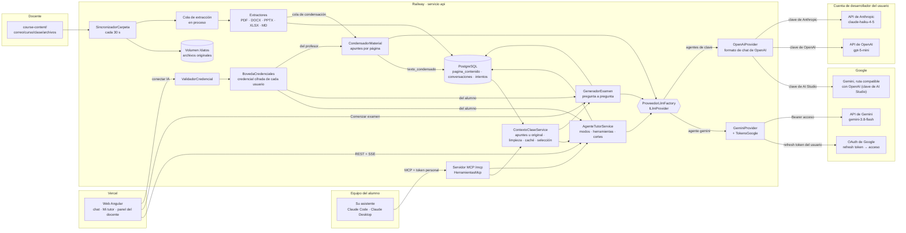

### Flujo 1: el profesor sube material

El profesor no usa formularios: copia el archivo en su carpeta (§6.1). En producción la carpeta viaja en la imagen de la API, así que subir material es hacer commit en `course-content/` y dejar que el CD despliegue.

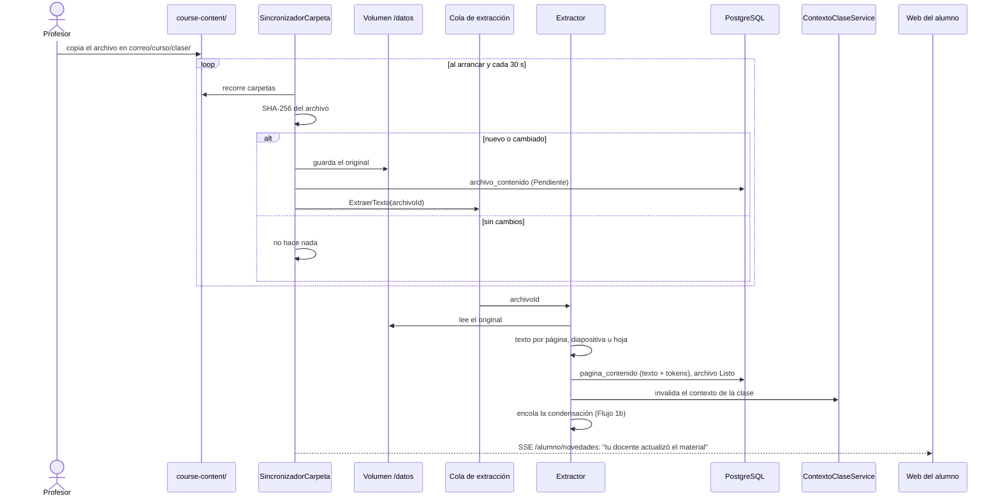

El texto se extrae **una sola vez**, al subir. Ninguna pregunta del alumno vuelve a leer un documento.

### Flujo 1b: la IA condensa el material (RF-36)

Justo después de extraer el texto, en segundo plano y una sola vez por archivo, la IA reescribe cada página como apuntes compactos. Mientras tanto, o si no se puede, el tutor lee el original: nada espera a la condensación.

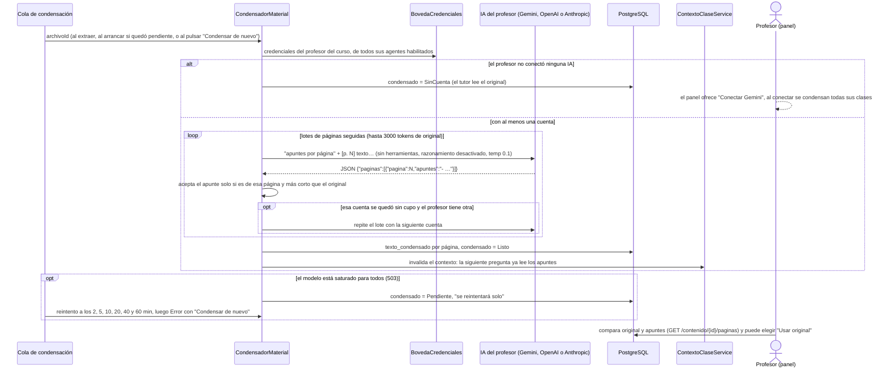

El condensador usa las IA que el profesor tenga conectadas, sea por clave o por cuenta de Google: empieza por una y solo pasa a la siguiente si la primera corta por límite de uso. El panel del docente ofrece conectar Gemini con su cuenta de Google; la clave de API la conecta entrando como alumno, en *Mi tutor*. Si un intento se cortó por saturación, las páginas ya condensadas se conservan y no vuelven a gastar cupo.

Una página de menos de 60 tokens ya es un apunte y no se condensa. Una página que la IA no devuelve, o devuelve más larga, se queda con su original. Si el texto del archivo cambia, sus apuntes se borran y se rehacen.

### Flujo 2: se prepara el material para la IA

Es el "archivo" que realmente recibe el modelo: el bloque `<contenido>` de la clase. Hay dos versiones en caché por clase: la del tutor, con los apuntes condensados donde los hay, y la original, para generar el examen. Cada una se arma una vez y se rehace cuando cambia el material, sus apuntes o la elección del profesor.

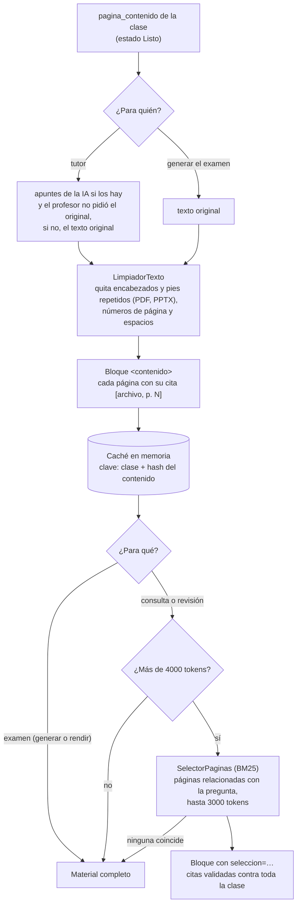

### Flujo 3: el alumno consulta al agente

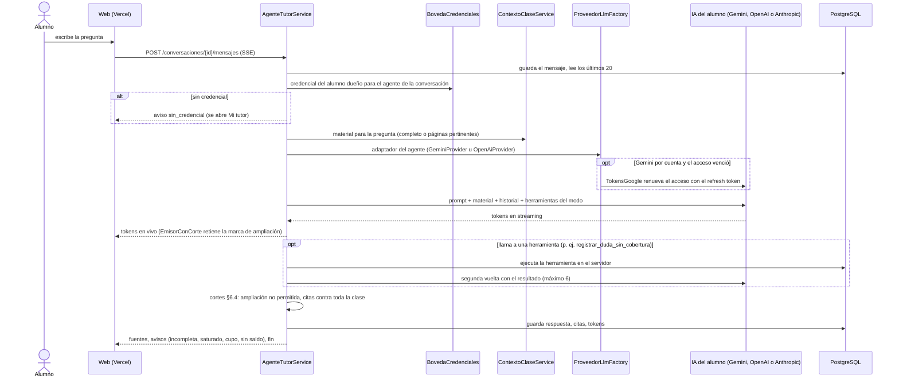

Si el proveedor responde con un error, no se reintenta a ciegas (tabla de §5.8):
- 503 de Gemini: *modelo saturado, reintenta en segundos*;
- 429 del cupo propio: *podrás seguir en N min*;
- cuenta de pago sin saldo: *carga saldo o conversa con otra IA*;
- 401 o 403: la credencial se marca inválida y *Mi tutor* pide reconectarla.

En ningún caso se pierde el avance.

### Flujo 4: se genera el examen del alumno

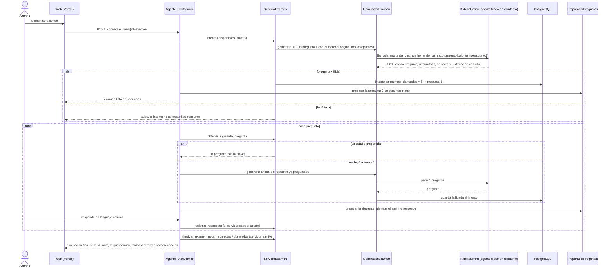

Rendir el examen es el mismo Flujo 3 en modo Evaluación, con dos diferencias:
- el agente solo tiene `obtener_siguiente_pregunta`, `registrar_respuesta`, `obtener_progreso` y `finalizar_examen`;
- la clave de respuestas nunca entra en su contexto.

La calificación la hace el servidor, sin IA (§5.3); la evaluación cualitativa del final la hace la IA (§5.4).

### Flujo 5: el usuario conecta Gemini con su cuenta de Google (RF-37)

El mismo cliente OAuth web del inicio de sesión, con un permiso más. El refresh token no pasa nunca por el navegador.

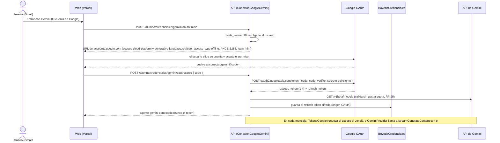

Si el usuario revoca el acceso en su cuenta de Google, la renovación responde `invalid_grant`: la credencial se marca inválida y el chat pide reconectar (RF-28). Si la API de Gemini no está activada en el proyecto, el error es de la plataforma y la credencial del usuario sigue válida.

### Flujo 6: el alumno conecta su clave de API (RF-38)

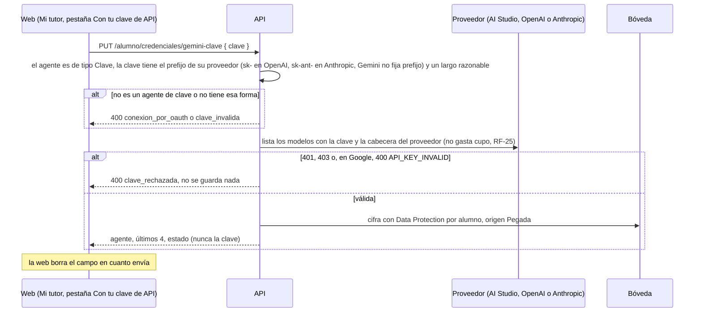

En cada mensaje la API descifra la clave solo para la llamada saliente y usa `OpenAiProvider` con la ruta del proveedor (§5.8). Un 401 posterior la marca inválida y *Mi tutor* pide pegar una nueva (RF-28).

### Flujo 7: el alumno estudia desde su asistente (RF-39)

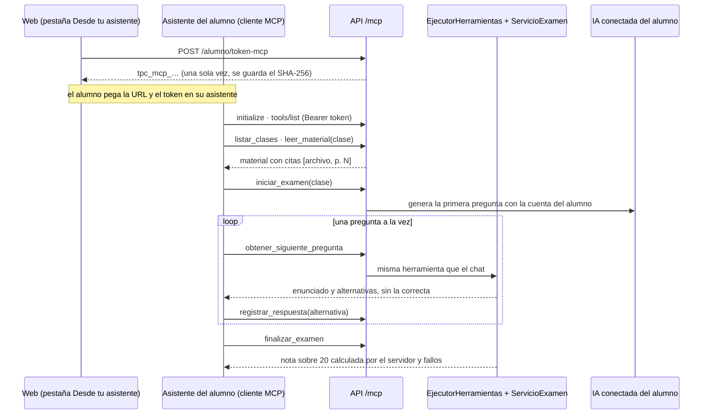

El asistente nunca recibe la clave de respuestas antes de finalizar ni puede escribir la nota: las herramientas son las del chat y pasan por el mismo `EjecutorHerramientas`, que comprueba el modo y los intentos. El servidor MCP envía como instrucciones las reglas del tutor (§6.3): citar el material, marcar la ampliación y no dar pistas durante el examen. La sesión de la web no abre `/mcp`, y el token MCP no abre el resto de la API.

---

[← 4. Modelo de datos](04-modelo-de-datos.md) · [Índice del SDD](SDD-Plataforma-Evaluacion-PreClase.md) · [6. Módulo de contenido de clase →](06-contenido-de-clase.md)
